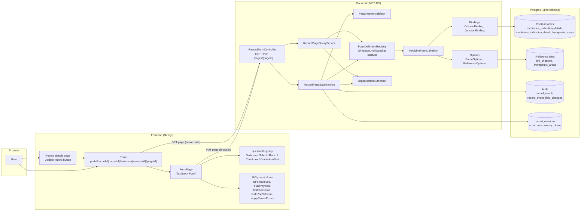
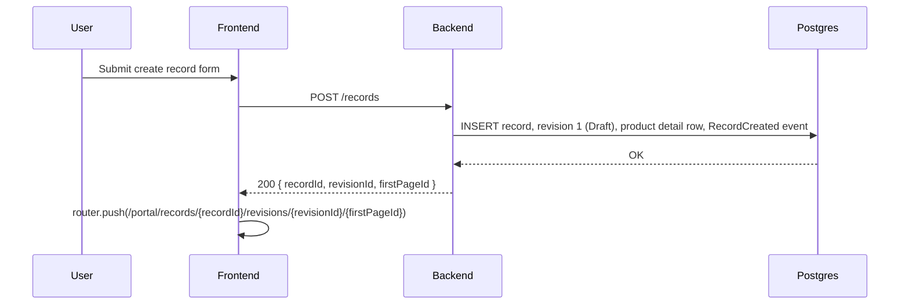
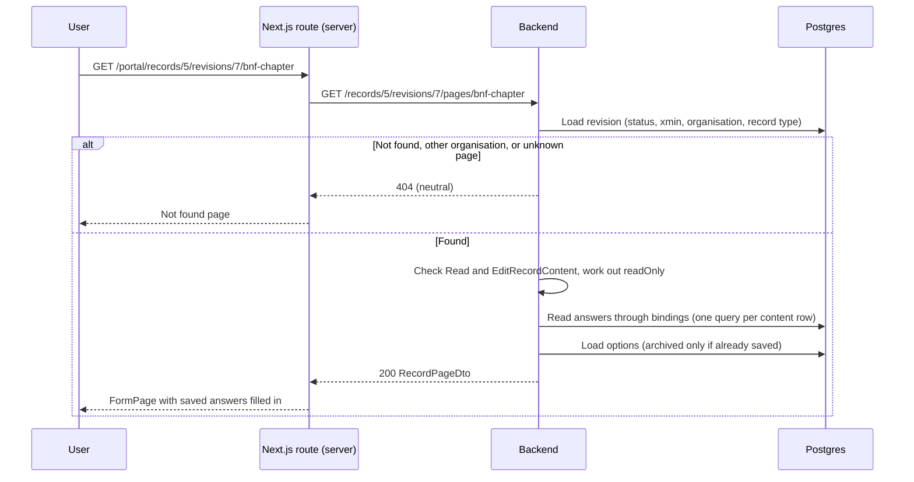
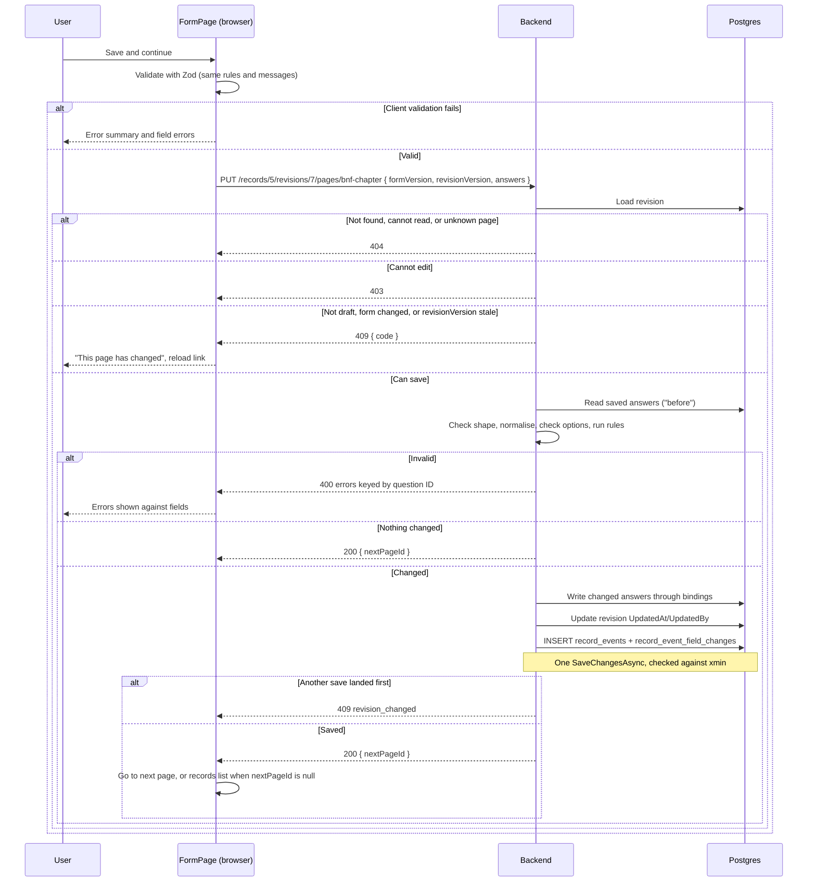

# Record content forms: high-level design

This document describes how record content pages (the questions a company answers about a
medicine or vaccine) are defined, rendered, validated and saved. For a step-by-step guide to
adding a page, see [Creating form pages](creating-form-pages.md). For reference data such as BNF
chapters, see [Reference data](reference-data.md). The key decisions are recorded in
[ADR-006](../ADR/ADR-006-dynamic-record-content-forms.md).

The original plan is the [form builder brief](ukps-form-builder.md). Where it and this
document disagree, this document and the code are correct.

## Overview

Each page of a record's content is described by a **form definition written in C#**. The
backend serves one page at a time as JSON: its questions, validation rules, options and the
current answers. The frontend renders the page from that description, validates it with the same
rules, and sends every answer on the page to one generic save endpoint. The backend validates
again, writes each changed answer to its typed column or table, audits the change and returns
the next page.

There is no generic answers table. Answers live in the existing typed content tables (for
example `medicines_indication_details`), and **bindings** map each question onto its column or table.

### What is built today

| Area | Status |
|---|---|
| Medicine form, section "Indication details" | 5 pages: indication, BNF chapter, therapeutic area, treating children, treating cancer |
| Question types | `Textarea`, `Radio`, `Select`, `Checkbox` (with an optional `combobox` display hint) |
| Rules | `Required`, `MaxLength`, `MaxItems` |
| Bindings | Column (string, enum, reference ID) and junction table |
| Entry points | Record creation redirects to the first page; **Update record** on the record details page opens the first page |
| Audit | One event per save, one row per changed answer |
| Not built yet | Conditional pages and questions, add-another groups, precision dates, vaccine forms, tasklist |

## Architecture



### Where the code lives

| Concern | Location |
|---|---|
| Definition model and builder | `backend/src/Application/Forms/Definitions/` |
| Bindings | `backend/src/Application/Forms/Bindings/` |
| Rules | `backend/src/Application/Forms/Rules/` |
| Options | `backend/src/Application/Forms/Options/` |
| Medicine form | `backend/src/Application/Forms/Medicines/MedicineFormDefinition.cs` |
| Services | `backend/src/Application/Forms/RecordPageQueryService.cs`, `RecordPageSaveService.cs`, `PageAnswerValidator.cs` |
| Controller | `backend/src/WebApi/Controllers/RecordFormController.cs` |
| Shared rule fixture | `backend/tests/Application/Forms/Fixtures/rule-cases.json` |
| Page route | `frontend/src/app/portal/records/[recordId]/revisions/[revisionId]/[pageId]/page.tsx` |
| Renderer and question components | `frontend/src/components/DynamicForm/` |
| Form logic | `frontend/src/lib/dynamic-form/` |

## Key concepts

### Definition hierarchy

`FormDefinition` (one per `RecordType`) contains ordered `SectionDefinition`s, each with ordered
`PageDefinition`s, each with ordered `QuestionDefinition`s. A question has an ID, type, label,
optional hint, optional display hint, rules, options (for choice questions) and a binding.

Definitions are built once at startup by `FormDefinitionRegistry.CreateDefault()` and checked by
`FormDefinitionValidator`. An invalid definition stops the API from starting. The registry holds
structure only: bindings receive the request's `AppDbContext`, and options are loaded per request.

Page order is form order. Back goes to the previous page, Save and continue goes to the next, and
saving the last page returns to the organisation's records list.

### Question IDs are a public contract

A question ID such as `medicines_indication_detail.indication` is used, unchanged, as:

- the key in the page's `answers`,
- the key in the save payload,
- the key in validation errors (`ValidationProblemDetails.errors`),
- the TanStack Form field name on the frontend,
- the `field_path` of the audit row.

Never change a released question ID: doing so breaks audit history and any saved client state.

### Bindings

Bindings are the only form code that touches EF entities. Each one reads and writes one answer:

- `ColumnBinding` reads or writes one property of the revision's content row. It converts
  strings as-is, enums to and from their member names, and integer foreign keys to and from
  strings.
- `JunctionBinding` maps a multi-select to a junction table. Writing compares the submitted set
  with the stored rows and inserts or deletes only the difference.

Content rows are found by `RevisionId` through `ContentRows`. Record creation does not insert a
`MedicinesIndicationDetail` row, so until the first save its questions read as unanswered, and
the first save that writes to it creates it. Rows can only be created this way if their
`ContentRows` entry has a factory that sets every required column.

### Options

- `EnumOptions`: a fixed list for an enum column, displayed in the order declared.
- `ReferenceOptions`: loaded from a reference data table on each request. Archived items are
  hidden unless they are the value already saved, in which case they stay selectable.

Option values are always strings on the wire (enum names, or reference IDs as strings).

### Validation

The server is authoritative; the client mirrors it so users see errors without a round trip.

1. Text answers are trimmed, and whitespace-only becomes `null`. Multi-select answers are sorted
   so that the same selection in a different order is not a change.
2. Each question's rules run in the order declared. The first failing rule's message is the one
   error reported for that question.
3. On the server only: every page question must be present with the right JSON shape, no other
   keys are allowed, and every selected value must be an offered option.

The message for each rule is written in the C# definition and shown verbatim on both sides. The
shared fixture `rule-cases.json` is run by both `RuleFixtureTests` (xUnit) and
`ruleFixture.test.ts` (Vitest), so the two implementations cannot drift apart.

### Versions and concurrency

- **`formVersion`**: the definition's version string (for example `2026.10.2`). The client echoes
  it on save; a mismatch returns 409 `form_version_changed`. `MedicineFormDefinitionTests` pins a
  fingerprint of the definition, so changing the definition without bumping the version fails
  the build.
- **`revisionVersion`**: the revision's Postgres `xmin` (`RecordRevision.Version`). The client
  echoes it on save; a stale value returns 409 `revision_changed`. Every save that changes
  something updates the revision row, so the token moves on. A save racing another one is caught
  by EF's concurrency check and also returns `revision_changed`.

### Authorisation and read-only pages

- Reading a page needs `Operation.Read` on the record's organisation.
- Saving needs `Operation.EditRecordContent` as well, which Standard, Champion and Super users
  have.
- Only draft revisions can be edited. A page is served with `readOnly: true` when the revision is
  not a draft or the caller cannot edit; the frontend disables inputs and hides Save.
- A missing record, revision or page and a record the caller cannot read all return the same
  neutral 404 ([ADR-004](../ADR/ADR-004-authorisation-failures-and-resource-concealment.md)).

## Sequences

### Creating a record



The record details page (`/portal/organisations/{id}/records/{recordId}`) links its **Update
record** button to the same URL, using the record's `revisionId` and `firstPageId` from
`GET /records/{id}`, so users can return to a record and change their answers.

### Loading a page



### Saving a page



## API contract

| Method | Route | Purpose |
|---|---|---|
| GET | `/records/{recordId}/revisions/{revisionId}/pages/{pageId}` | Page structure, rules, options and current answers |
| PUT | `/records/{recordId}/revisions/{revisionId}/pages/{pageId}` | Validate and save every answer on the page |

JSON property names are camelCase, except answer and error keys, which are question IDs exactly
as defined. Enum values are serialised as declared, for example `"Textarea"` and `"Required"`.
The examples below use the therapeutic area page of record 5, revision 7.

### GET response (`RecordPageDto`)

| Field | Meaning |
|---|---|
| `formVersion`, `revisionVersion` | Echo both back on save |
| `readOnly` | Show the page without Save |
| `organisationId` | Used for links back to the records list |
| `section`, `page` | IDs and titles; the section title is the page caption |
| `previousPageId` | Target of Back, or `null` on the first page |
| `questions` | `id`, `type`, `label`, `hint`, `display`, `rules` (`kind`, `value`, `message`), `options` (`value`, `label`) |
| `answers` | Every page question: a string or `null`, or an array for checkboxes |
| `context` | Earlier answers this page depends on; empty until conditions are built |

`GET /records/5/revisions/7/pages/therapeutic-area` returns `200 OK`:

```json
{
  "formVersion": "2026.10.2",
  "revisionVersion": 4711,
  "readOnly": false,
  "organisationId": 3,
  "section": { "id": "indication-details", "title": "Indication details" },
  "page": { "id": "therapeutic-area", "title": "Therapeutic area" },
  "previousPageId": "bnf-chapter",
  "questions": [
    {
      "id": "medicines_indication_detail_therapeutic_area",
      "type": "Checkbox",
      "label": "Select the most appropriate therapeutic area for this product (optional)",
      "hint": "Select up to 3 therapeutic areas. If you are unsure, you can move on and answer this question later.",
      "display": "combobox",
      "rules": [
        { "kind": "MaxItems", "value": 3, "message": "Select up to 3 therapeutic areas" }
      ],
      "options": [
        { "value": "1", "label": "1: Addiction" },
        { "value": "2", "label": "2: Allergy" },
        { "value": "3", "label": "3: Analgesia, Anesthesiology, or Anti-inflammatory" },
        { "value": "14", "label": "14: Oncology" }
      ]
    }
  ],
  "answers": {
    "medicines_indication_detail_therapeutic_area": ["14"]
  },
  "context": {}
}
```

The options list is shortened here; the real response has all 20 areas. Other question types
differ only in their answers and options. A single-value question has a string or `null` answer,
and a `Textarea` has no options (`null`):

```json
{
  "questions": [
    {
      "id": "medicines_indication_detail.indication",
      "type": "Textarea",
      "label": "What is the indication this product is seeking a licence for?",
      "hint": "Describe the indication as you intend to apply for licensing in the UK. When you know them, include specific details such as line of therapy and subgroups.\n\nYou can edit these details at any time throughout product development.",
      "display": null,
      "rules": [
        { "kind": "Required", "value": null, "message": "Enter the indication this product is seeking a licence for" },
        { "kind": "MaxLength", "value": 2000, "message": "Indication must be 2000 characters or fewer" }
      ],
      "options": null
    }
  ],
  "answers": {
    "medicines_indication_detail.indication": null
  }
}
```

A page the caller cannot load returns `404 Not Found` (see the 404 example below).

### PUT

Request: `{ formVersion, revisionVersion, answers }`, with every question on the page present.
Send `null` for an unanswered single-value question and `[]` for an unanswered checkbox.

| Status | When | Body |
|---|---|---|
| 200 | Saved, or nothing changed | `{ nextPageId }` (`null` after the last page) |
| 400 | Missing, unknown or malformed answers, invalid options, failed rules | `ValidationProblemDetails`, keyed by question ID |
| 403 | Can read the record but not edit it | `ProblemDetails` |
| 404 | Not found or not readable (concealed) | `ProblemDetails` |
| 409 | `revision_not_draft`, `revision_changed` or `form_version_changed` | `ProblemDetails` with `code` |

#### Request

`PUT /records/5/revisions/7/pages/therapeutic-area`:

```json
{
  "formVersion": "2026.10.2",
  "revisionVersion": 4711,
  "answers": {
    "medicines_indication_detail_therapeutic_area": ["14", "2"]
  }
}
```

The order of checkbox values does not matter; the server sorts them before comparing.

#### 200 OK

```json
{ "nextPageId": "paediatric" }
```

Saving the last page (`cancer`) returns `{ "nextPageId": null }`, and the frontend goes to the
organisation's records list.

#### 400 Bad Request

One error per question, keyed by question ID. Keys that are not questions on the page are reported
under their own key:

```json
{
  "type": "https://tools.ietf.org/html/rfc9110#section-15.5.1",
  "title": "One or more validation errors occurred.",
  "status": 400,
  "errors": {
    "medicines_indication_detail_therapeutic_area": ["Select up to 3 therapeutic areas"],
    "medicines_indication_detail.indication": ["This is not a question on this page."]
  },
  "traceId": "00-4bf92f3577b34da6a3ce929d0e0e4736-00f067aa0ba902b7-01"
}
```

The server's own messages, used for problems the definition does not describe:

| Problem | Message |
|---|---|
| A page question is missing from `answers` | `Provide an answer for this question, or null if it is unanswered.` |
| A key is not a question on this page | `This is not a question on this page.` |
| Wrong JSON shape (for example a number, or a string for a checkbox) | `The answer is not in the expected format.` |
| A value that is not an offered option | `Select a valid option.` |

#### 403 Forbidden

```json
{
  "type": "https://tools.ietf.org/html/rfc9110#section-15.5.4",
  "title": "Forbidden",
  "status": 403,
  "detail": "You are not authorised to edit this record.",
  "traceId": "00-4bf92f3577b34da6a3ce929d0e0e4736-00f067aa0ba902b7-01"
}
```

#### 404 Not Found

The same body for a missing record, revision or page and for a record in another organisation
(GET and PUT):

```json
{
  "type": "https://tools.ietf.org/html/rfc9110#section-15.5.5",
  "title": "Not Found",
  "status": 404,
  "detail": "The specified page could not be found.",
  "traceId": "00-4bf92f3577b34da6a3ce929d0e0e4736-00f067aa0ba902b7-01"
}
```

#### 409 Conflict

```json
{
  "type": "https://tools.ietf.org/html/rfc9110#section-15.5.10",
  "title": "Conflict",
  "status": 409,
  "detail": "This record has changed since the page was loaded.",
  "code": "revision_changed",
  "traceId": "00-4bf92f3577b34da6a3ce929d0e0e4736-00f067aa0ba902b7-01"
}
```

| `code` | `detail` |
|---|---|
| `revision_not_draft` | `This record can no longer be edited because it has been submitted.` |
| `revision_changed` | `This record has changed since the page was loaded.` |
| `form_version_changed` | `This form has changed since the page was loaded.` |

## Audit

Every save that changes something writes:

- one `record_events` row with `event_type = 7` (`RecordContentUpdated`), the record and
  revision IDs, the user and time, and `note` set to the page ID;
- one `record_event_field_changes` row per changed question, with `field_path` set to the
  question ID.

Values are stored as text. Single values are stored raw (`Unknown`, `12`, the indication text) so
they can be queried directly, for example to report on fields moving away from `Unknown`.
Multi-select values are stored as JSON (`["4","7"]`). No answer is stored as `null`.

## Known limitations and next steps

- Conditional pages and questions (`ShowWhen`, `requiredWhen`) and clearing answers that no longer
  apply are not built. `context` is always empty.
- Add-another groups, precision dates and their bindings are not built.
- Therapeutic area uses a checkbox list until the searchable combobox replaces `ComboboxSlot`.
- The select placeholder is a generic "Choose an option"; definitions have no placeholder text.
- There is no tasklist: "Return to tasklist" and the last page go to the records list.
- Pages do not set a browser `<title>`.
- Only top-level BNF chapters are seeded.
- Vaccine records have no form yet, and record creation only creates medicine records.
