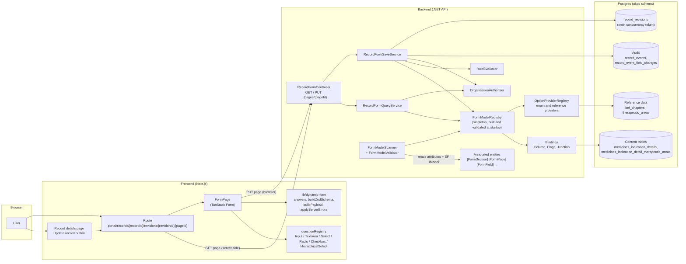
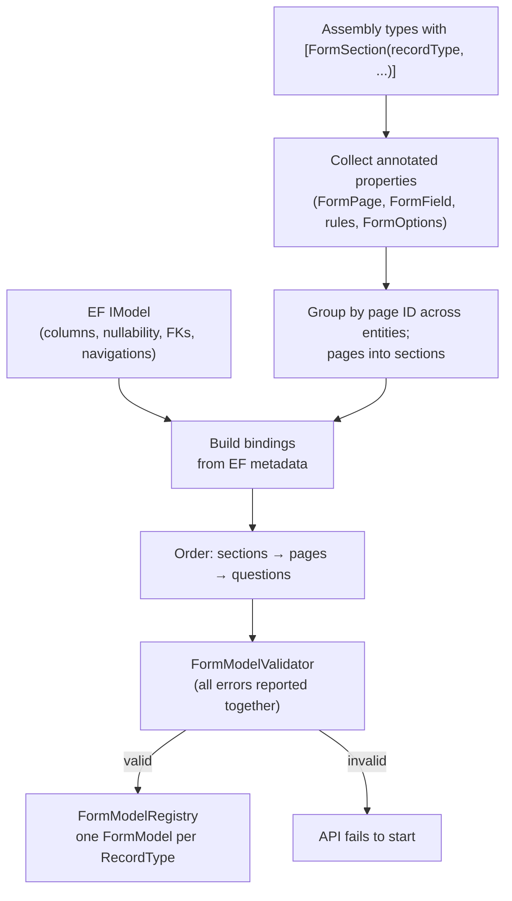
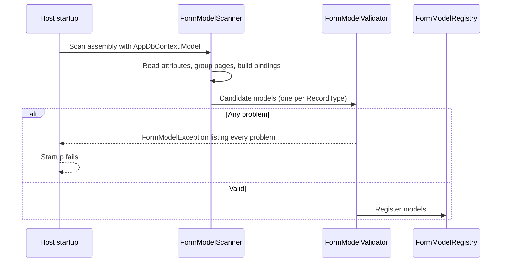
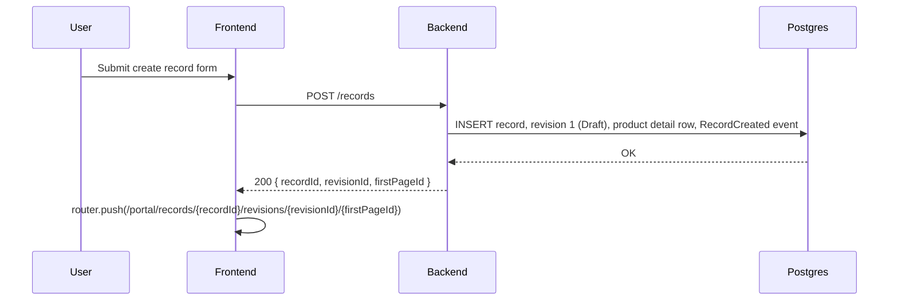
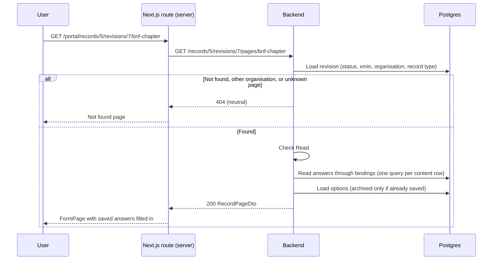
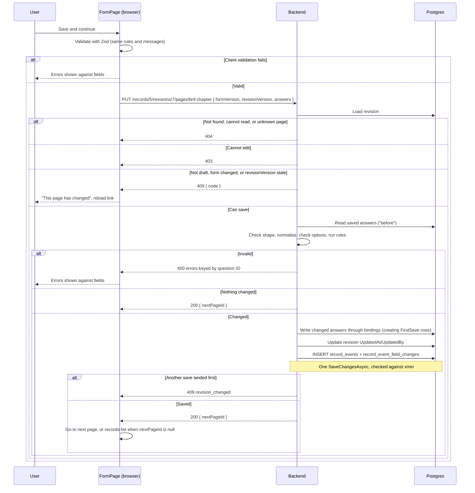

# Record content forms: high-level design

> **Status: first delivery implemented** (Medicine form, Indication details section). The
> decision is recorded in
> [ADR-006](../ADR/ADR-006-attribute-annotated-record-content-forms.md).

This document describes how record content pages (the questions a company answers about a
medicine or vaccine) are declared, rendered, validated and saved:

- For a step-by-step guide to annotating an entity, see [Creating form pages](creating-form-pages.md).
- For the lists that options come from, see [Reference data](reference-data.md).
- For the database effects of each save, see the [walkthrough](record-creation-walkthrough.md).

The earlier [form builder brief](ukps-form-builder.md) used a separate C# form definition.
That idea is replaced here, and the brief is kept only as background.

## Overview

The form is declared **on the EF content entities themselves**, using attributes. Each property that
a user answers carries the question's ID, label, hint, page, rules and options. Every other
property is explicitly ignored, with a reason.

```csharp
[FormSection(RecordType.Medicine, "indication-details", "Indication details", Order = 20)]
internal sealed class MedicinesIndicationDetail
{
    [FormIgnore("Database identity")]
    public int Id { get; set; }

    [FormPage("indication", "Indication", Order = 10)]
    [FormField(
        "medicines_indication_detail.indication",
        "What is the indication this product is seeking a licence for?",
        FormControl.Textarea)]
    [FormRequired("Enter the indication this product is seeking a licence for")]
    [FormMaxLength(2000, "Indication must be 2000 characters or fewer")]
    public string? Indication { get; set; }

    // ...
}
```

The backend works as follows:

1. At startup, a **scanner** reads these attributes and the EF model and builds an in-memory
   **form model**, one for each record type. A **validator** checks the model; if it finds a
   problem, the API does not start.
2. The backend serves one page at a time as JSON: its questions, rules, options and current
   answers.
3. The frontend renders the page from that JSON and validates it with the same rules. It then
   sends every answer on the page to one generic save endpoint.
4. The backend validates again and writes each changed answer to its typed column or table. It
   audits the change and returns the next page.

There is no generic answers table. Answers stay in the existing typed content tables, for example
`medicines_indication_details`. The scanner derives a **binding** for each question from the EF
model, telling it which column or junction table holds the answer.

### Why attributes

- **Locality.** A column and the question that fills it sit side by side. You can't add a column
  to a content entity without deciding whether it is on a form, because the coverage check
  rejects unannotated properties.
- **Renames are safe.** Bindings come from the property itself, not from a string or a separate
  expression. The question ID, which is the public contract, is written out explicitly, so
  renaming a property in C# never changes it.
- **One source of truth.** No separate definition file can drift from the entities.

### Proposed first delivery

| Area | Scope |
|---|---|
| Medicine form, section "Indication details" | 6 pages: indication, BNF chapter, therapeutic area, treating children, treating cancer, treating a rare disease |
| Controls | `Text`, `Textarea`, `Radio`, `Select`, `Checkbox`, `HierarchicalSelect` (a parent dropdown, then an optional child dropdown; on a junction it repeats with "add another") |
| Rules | `Required`, `MaxLength`, `MaxItems` |
| Bindings | Column (string, enum, reference ID), flags enum, junction table |
| Entry points | Record creation redirects to the first page; **Update record** on the record details page opens the first page. Both use `firstPageId`, returned by `POST /records` and `GET /records/{id}` |
| Audit | One event per save, one row per changed answer |
| Later | Conditional pages and questions, add-another groups, precision dates, vaccine forms, tasklist, searchable combobox |

## Architecture



### Where the code will live

| Concern | Location |
|---|---|
| Attributes (pure metadata, no Application dependency) | `backend/src/Persistence/FormAnnotations/` |
| Annotated entities | `backend/src/Persistence/Entities/*RevisionContent/` |
| Form model (`FormModel`, `FormSection`, `FormPage`, `FormQuestion`) | `backend/src/Application/RecordForms/Model/` |
| Scanner, validator, builder, fingerprint | `backend/src/Application/RecordForms/Scanning/` |
| Form versions | `backend/src/Application/RecordForms/FormVersions.cs` |
| Bindings | `backend/src/Application/RecordForms/Bindings/` |
| Option providers | `backend/src/Application/RecordForms/Options/` |
| Rules | `backend/src/Application/RecordForms/Rules/` |
| Services | `backend/src/Application/RecordForms/RecordFormQueryService.cs`, `RecordFormSaveService.cs`, sharing `RecordFormPageLoader.cs` |
| Server-side page validation | `backend/src/Application/RecordForms/Rules/PageAnswerValidator.cs`, `AnswerParser.cs`, `RuleEvaluator.cs` |
| Controller | `backend/src/WebApi/Controllers/RecordFormController.cs` |
| Shared rule fixture | `backend/tests/Application/RecordForms/Fixtures/rule-cases.json` (run by `RuleCasesTests` and `frontend/src/lib/dynamic-form/ruleCases.test.ts`) |
| Page route | `frontend/src/app/portal/records/[recordId]/revisions/[revisionId]/[pageId]/page.tsx` |
| Renderer and question components | `frontend/src/components/DynamicForm/` (`FormPage.tsx`, `questionRegistry.tsx`, `questions/`) |
| Form logic | `frontend/src/lib/dynamic-form/` |

The attributes live in Persistence, so entities stay free of Application types. Everything that
interprets the attributes lives in Application.

## Key concepts

### From attributes to a form model



The form model is `FormModel → FormSection → FormPage → FormQuestion`. It is a plain immutable
object graph, so the rest of the system never touches attributes or reflection:

- **`FormModel`**: one per `RecordType`. Holds the version, the ordered sections, a flat
  ordered list of pages, and `FindPage`, `NextPage` and `PreviousPage`.
- **`FormSection`**: ID, title and ordered pages.
- **`FormPage`**: ID, title, section, and ordered questions.
- **`FormQuestion`**: ID, control, label, hint, display hint, rules, option provider key and
  binding.

The registry is a singleton built from the EF design-time model of an `AppDbContext` created
without a connection string (`FormModelFactory.LoadModel`), so it never depends on database
settings. `FormModelStartupCheck`, a hosted service, resolves it when the API starts, so an
invalid model stops the API starting. It holds structure only: bindings receive the request's
`AppDbContext`, and options are loaded per request.

### Sections, pages and ordering

- **Sections.** `[FormSection(recordType, id, title, Order = n)]` on an entity puts the entity's
  questions into that section of that record type's form. Several entities can declare the same
  section ID, as long as they agree on its title and order. An entity can carry one
  `[FormSection]` per record type. A shared entity such as `RecordProductDetail` can therefore
  take part in both the Medicine and Vaccine forms.
- **Pages.** `[FormPage(id, title, Order = n)]` on a property places its question on that page.
  The page's `Order` places it within its section.
- **Questions.** On a page with several questions, `FormField.Order` sets their order.
- **Form order** is section order, then page order. Back goes to the previous page and Save and
  continue goes to the next. Saving the last page returns to the organisation's records list.
- **No ties.** Two sections or pages with the same `Order`, or two questions on the same page
  with the same `Order`, fail startup. Attribute order in source is never relied on.

### Pages that span entities

A page ID is unique within a form, not within an entity. When properties on **different
entities** declare the same `[FormPage]` ID, their questions are merged into one page:

- every declaration of that page ID must agree on title and order;
- the declaring entities must all be in the same section.

The startup check enforces both.

Saving a merged page writes to several tables in one `SaveChangesAsync` and one audit event.

### Coverage: every column is accounted for

In an entity with `[FormSection]`, every **mapped scalar property** (according to the EF model)
must carry exactly one of the following, or the API does not start:

- `[FormField]`: it is a question. It also needs `[FormPage]`.
- `[FormIgnore("reason")]`: it is deliberately not a question, for example "Database
  identity" or "Revision ownership is supplied by the server". The reason must not be blank.

Navigation properties need no annotation, unless they back a junction question (see below).
The coverage rule means a newly added column either becomes a question or is visibly marked as
not one. It can never be silently left off the form.

### Controls

Every `[FormField]` names its control as its third argument, so the control is always visible
in the entity and a missing one is a compile error. The scanner checks it suits the property:

| Property | Allowed controls |
|---|---|
| `string` | `Text`, `Textarea` |
| non-flags enum (nullable or not) | `Radio`, `Select` |
| `int` / `int?` foreign key to reference data | `Radio`, `Select`, `HierarchicalSelect` |
| `[Flags]` enum | `Checkbox` |
| navigation collection to a junction entity | `Checkbox`, `HierarchicalSelect` |

Choice controls (`Radio`, `Select`, `Checkbox`, `HierarchicalSelect`) need an option provider,
found by the property's type or named with `[FormOptions]`; `Text` and `Textarea` must not have
`[FormOptions]`.

### Hierarchical selects

BNF chapter and therapeutic area are two-level choices: a parent dropdown, then, once a parent
with children is chosen, an optional child dropdown (the BNF subchapter, or the disease or
condition). `HierarchicalSelect` covers both:

- **Storage is unchanged.** The answer is the **most specific option chosen**: the child if one
  is picked, otherwise the parent. It is stored in the existing column (`bnf_chapter_id`) or
  junction rows, so the wire format stays a single ID string or an ID array.
- **The frontend works out the parent** from the options tree when it loads a saved child, so a
  seeded record that stores a BNF section or a child therapeutic area loads straight into the
  pair.
- **Options are a tree.** A `HierarchicalSelect` needs a tree provider (`AddReferenceTree`); each
  option has `children`. Any node in the offered tree is a valid answer.
- **On a junction it repeats.** Each entry is a parent and child pair; **Add another** (the
  `AddAnotherLabel`) adds entries up to the `MaxItems` rule, and later entries can be removed.
  Choosing the same option twice is rejected.
- **Wording comes from `FormField`:** `Placeholder` (the parent's empty option), `ChildLabel`
  (required; the child dropdown's heading), `ChildPlaceholder` and `AddAnotherLabel`.
- Both dropdowns are plain `Select`s for now; `Display = "combobox"` is kept so a searchable
  combobox can replace the child list later.

### Question IDs are a public contract

The ID is written out in `[FormField]`, for example `medicines_indication_detail.indication`. It is
used, unchanged, as:

- the key in the page's `answers`,
- the key in the save payload,
- the key in validation errors (`ValidationProblemDetails.errors`),
- the `field_path` of the audit row.

TanStack Form reads dots in a field name as a nested path, so the frontend names each field by
its position on the page (`q0`, `q1`, …) and maps to and from question IDs when it loads answers,
builds the payload and applies server errors (`lib/dynamic-form/answers.ts`).

The convention is `snake_entity.snake_property`, using the singular entity name. Junction
questions use the junction entity name alone, for example
`medicines_indication_detail_therapeutic_area`.

The ID is deliberately **not** derived from the property name. Renaming a C# property must not
change it. **Never change a released question ID**: doing so breaks audit history and any saved
client state.

### Bindings

Bindings are the only form code that touches EF entities. The scanner builds them from EF
metadata, so attributes never contain expressions:

- **`ColumnBinding`** reads or writes one property of the revision's content row. Strings are
  passed as-is, enums convert to and from their member names, and integer foreign keys convert
  to and from strings.
- **`FlagsBinding`** maps a `[Flags]` enum property to a sorted `string[]` of member names, and
  combines them with OR on write.
- **`JunctionBinding`** is built from an annotated navigation collection such as
  `MedicinesIndicationDetail.TherapeuticAreas`. It reads EF metadata to find the junction's
  owner foreign key and its reference foreign key. On write, it compares the submitted set with
  the stored rows and inserts or deletes only the difference.

#### Content rows

The content row is found by the convention that every `[FormSection]` entity has an `int
RevisionId` foreign key to `RecordRevision`. The validator checks this. `FormSection.RowSource`
says how the row comes to exist:

- **`FirstSave` (default).** Until the first save, the revision has no row, so its questions
  read as unanswered. The first save that writes to the entity creates the row. This is only
  allowed when the entity has no non-nullable columns other than the key and `RevisionId`
  (unless they have a database default), because no page is guaranteed to be saved first.
  `MedicinesIndicationDetail` qualifies.
- **`RecordCreation`.** Record creation inserts the row, as it does for `RecordProductDetail`,
  which has non-nullable `CompanyCode` and `RecordTitle`. A missing row is then a server error,
  not something a save repairs.

### Options

Attributes can't hold queries or tuples, so options come from **named providers** registered in
C#. A question uses the one provider registered for its type: the enum provider of its enum, or
the reference (or, for a `HierarchicalSelect`, reference tree) provider of its referenced
entity. When several providers offer the same type, the property chooses one by key:
`[FormOptions(OptionKeys.BnfChapters)]`, or a raw string such as `[FormOptions("bnf-chapters")]`.
The resolved key is part of the form fingerprint either way.

- **`EnumOptionProvider<TEnum>`** is a fixed list of enum members with labels, shown in the
  order given. The startup check makes sure its enum matches the bound property's enum.
- **`ReferenceOptionProvider<T>`** runs an EF query and projection against a reference data
  table on each request. Archived items are hidden unless they are the value already saved, in
  which case they stay selectable. Registered with `AddReference` it offers a flat list; with
  `AddReferenceTree` it offers two levels, parents with children, linked by the projection's
  `ParentId`. If a saved child's parent is archived, the parent stays visible so the child can
  be shown.

Providers live in `Application/RecordForms/Options/` (for example `MedicineOptionProviders.cs`),
and the keys are string constants in `Persistence/FormAnnotations/OptionKeys.cs`, so entities can
name them in `[FormOptions]` without depending on Application. Option values are always strings on the wire: enum
names, or reference IDs as strings.

### Validation

The server is authoritative; the client mirrors it so users see errors without a round trip.

1. Text answers are trimmed, and whitespace-only becomes `null`. Multi-select answers are sorted
   so that the same selection in a different order is not a change.
2. Each question's rules run in a **fixed order by kind** (`Required`, `MaxLength`, `MaxItems`).
   .NET does not guarantee attribute order, so source order is never used. Only the first
   failing rule's message is reported for that question.
3. On the server only:
   - every page question must be present with the right JSON shape;
   - no other keys are allowed;
   - every selected value must be an offered option;
   - a multi-value answer must not repeat a value.

Rule messages are written in the attributes and shown verbatim on both sides. The shared
fixture `rule-cases.json` is run by both xUnit and Vitest, so the two implementations cannot
drift apart.

### Startup checks

`FormModelValidator` collects **every** problem and reports them together in one exception, so a
broken build lists everything to fix at once. The full catalogue is in
[Creating form pages](creating-form-pages.md#startup-checks).

### Versions and concurrency

- **`formVersion`** is the form's version string, held in code as `FormVersions.Medicine` (for
  example `2026.10.1`). The client echoes it on save, and a mismatch returns 409
  `form_version_changed`.
  - `FormModelFingerprint` hashes everything in the model that clients, saved data or audit
    depend on: IDs, labels, hints, controls, rules, option keys, bindings and order.
  - A unit test pins the fingerprint next to the version. Changing **any attribute** on a form
    entity without bumping the version fails the build.
- **`revisionVersion`** is the revision's Postgres `xmin` (`RecordRevision.Version`, a new `uint`
  configured with `IsRowVersion()`). The client echoes it on save, and a stale value returns 409
  `revision_changed`.
  - Every save that changes something updates the revision row, so the token moves on.
  - A save racing another one is caught by EF's concurrency check, which also returns
    `revision_changed`.

### Authorisation

- Reading a page needs `Operation.Read` on the record's organisation.
- Saving also needs a new `Operation.EditRecordContent`, granted to Standard, Champion and Super
  users. `Operation.Update` is unchanged.
- Only draft revisions can be edited: a save to any other revision is rejected with
  `revision_not_draft`. The form pages are only for editing; viewing a record without editing
  it is a separate flow.
- A missing record, revision or page, and a record the caller cannot read, all return the same
  neutral 404 ([ADR-004](../ADR/ADR-004-authorisation-failures-and-resource-concealment.md)).

## Sequences

### Starting the API



### Creating a record



The record details page (`/portal/organisations/{id}/records/{recordId}`) links its **Update
record** button to the same URL, using `revisionId` and `firstPageId` from
`GET /records/{id}`. This lets users return to a record and change their answers.

### Loading a page



### Saving a page



## API contract

| Method | Route | Purpose |
|---|---|---|
| GET | `/records/{recordId}/revisions/{revisionId}/pages/{pageId}` | Page structure, rules, options and current answers |
| PUT | `/records/{recordId}/revisions/{revisionId}/pages/{pageId}` | Validate and save every answer on the page |

JSON property names are camelCase, except answer and error keys, which are question IDs exactly
as declared. Enum values are serialised by name, for example `"Textarea"` and `"Required"`. The
examples below use record 5, revision 7.

### GET response (`RecordPageDto`)

| Field | Meaning |
|---|---|
| `formVersion`, `revisionVersion` | Echo both back on save |
| `organisationId` | Used for links back to the records list |
| `recordId`, `revisionId` | Used to build page URLs |
| `section`, `page` | IDs and titles; the section title is the page caption |
| `previousPageId` | Target of Back, or `null` on the first page |
| `questions` | `id`, `type` (the `FormControl`), `multiple` (the answer is an array), `label`, `hint`, `display`, `placeholder`, `childLabel`, `childPlaceholder`, `addAnotherLabel`, `rules` (`kind`, `value`, `message`), `options` (`value`, `label`, `children`) |
| `answers` | Every page question: a string or `null`, or an array for multi-value questions |
| `context` | Earlier answers this page depends on; empty until conditions are built |

`GET /records/5/revisions/7/pages/therapeutic-area` returns `200 OK`:

```json
{
  "formVersion": "2026.10.1",
  "revisionVersion": 4711,
  "organisationId": 3,
  "section": { "id": "indication-details", "title": "Indication details" },
  "page": { "id": "therapeutic-area", "title": "Therapeutic area" },
  "previousPageId": "bnf-chapter",
  "questions": [
    {
      "id": "medicines_indication_detail_therapeutic_area",
      "type": "HierarchicalSelect",
      "multiple": true,
      "label": "Select the most appropriate therapeutic area for this product (optional)",
      "hint": "Select up to 3 therapeutic areas. If you are unsure, you can move on and answer this question later.",
      "display": "combobox",
      "placeholder": "Choose a therapeutic area",
      "childLabel": "Select the disease or condition (optional)",
      "childPlaceholder": "Choose a disease or condition",
      "addAnotherLabel": "Add another therapy area",
      "rules": [
        { "kind": "MaxItems", "value": 3, "message": "Select up to 3 therapeutic areas" }
      ],
      "options": [
        {
          "value": "1",
          "label": "1: Addiction",
          "children": [
            { "value": "2", "label": "1.1: Opioid use disorder", "children": null },
            { "value": "3", "label": "1.2: Neonatal abstinence syndrome (NAS)", "children": null }
          ]
        }
      ]
    }
  ],
  "answers": {
    "medicines_indication_detail_therapeutic_area": ["2"]
  },
  "context": {}
}
```

The options list is shortened here; see [Reference data](reference-data.md) for what each
provider offers. A single-value question has a string or `null` answer, and a `Textarea` has no
options (`null`):

```json
{
  "questions": [
    {
      "id": "medicines_indication_detail.indication",
      "type": "Textarea",
      "label": "What is the indication this product is seeking a licence for?",
      "hint": "Describe the indication you intend to license in the UK.",
      "display": null,
      "rules": [
        { "kind": "Required", "value": null, "message": "Enter the indication this product is seeking a licence for" },
        { "kind": "MaxLength", "value": 2000, "message": "Indication must be 2000 characters or fewer" }
      ],
      "options": null
    }
  ],
  "answers": {
    "medicines_indication_detail.indication": null
  }
}
```

### PUT

Request: `{ formVersion, revisionVersion, answers }`, with every question on the page present.
Send `null` for an unanswered single-value question and `[]` for an unanswered checkbox. In C#,
`answers` is `Dictionary<string, JsonElement>`: one generic OpenAPI type, not one per page.

| Status | When | Body |
|---|---|---|
| 200 | Saved, or nothing changed | `{ nextPageId }` (`null` after the last page) |
| 400 | Missing, unknown or malformed answers, invalid options, failed rules | `ValidationProblemDetails`, keyed by question ID |
| 403 | Can read the record but not edit it | `ProblemDetails` |
| 404 | Not found or not readable (concealed) | `ProblemDetails` |
| 409 | `revision_not_draft`, `revision_changed` or `form_version_changed` | `ProblemDetails` with `code` |

#### Request

`PUT /records/5/revisions/7/pages/therapeutic-area`:

```json
{
  "formVersion": "2026.10.1",
  "revisionVersion": 4711,
  "answers": {
    "medicines_indication_detail_therapeutic_area": ["3", "2"]
  }
}
```

The order of checkbox values does not matter; the server sorts them before comparing.

#### 200 OK

```json
{ "nextPageId": "paediatric" }
```

Saving the last page returns `{ "nextPageId": null }`, and the frontend goes to the
organisation's records list.

#### 400 Bad Request

One error per question, keyed by question ID. A key that is not a question on the page is
reported under its own key:

```json
{
  "type": "https://tools.ietf.org/html/rfc9110#section-15.5.1",
  "title": "One or more validation errors occurred.",
  "status": 400,
  "errors": {
    "medicines_indication_detail_therapeutic_area": ["Select up to 3 therapeutic areas"],
    "medicines_indication_detail.indication": ["This is not a question on this page."]
  },
  "traceId": "00-4bf92f3577b34da6a3ce929d0e0e4736-00f067aa0ba902b7-01"
}
```

The server has its own messages for problems that the attributes do not describe:

| Problem | Message |
|---|---|
| A page question is missing from `answers` | `Provide an answer for this question, or null if it is unanswered.` |
| A key is not a question on this page | `This is not a question on this page.` |
| Wrong JSON shape (for example a number, or a string for a checkbox) | `The answer is not in the expected format.` |
| A value that is not an offered option | `Select a valid option.` |
| A multi-value answer repeats a value | `You have selected the same option more than once.` |

#### 403, 404 and 409

All three use `ProblemDetails`:

| Status | `detail` | `code` |
|---|---|---|
| 403 | `You are not authorised to edit this record.` | n/a |
| 404 | `The specified page could not be found.` (identical for every not-found or concealed case) | n/a |
| 409 | `This record can no longer be edited because it has been submitted.` | `revision_not_draft` |
| 409 | `This record has changed since the page was loaded.` | `revision_changed` |
| 409 | `This form has changed since the page was loaded.` | `form_version_changed` |

## Audit

Every save that changes something writes:

- one `record_events` row with `event_type = 7` (`RecordContentUpdated`, a new enum value). It
  holds the record and revision IDs, the user and time, and has `note` set to the page ID.
- one `record_event_field_changes` row per changed question, with `field_path` set to the
  question ID.

A merged page that spans several entities still writes **one** event.

Values are stored as text:
- Single values are stored raw (`Unknown`, `12`, the indication text), so they can be queried
  directly, for example to report on fields moving away from `Unknown`.
- Multi-select values (junction and flags) are stored as JSON (`["2","3"]`).
- No answer is stored as `null`.

## Persistence changes

One migration (`AddRecordContentForms`) adds:

- `RecordEventType.RecordContentUpdated = 7` (an enum value; no schema change);
- `RecordRevision.Version` (`uint`, `IsRowVersion()`, which Npgsql maps to `xmin`), following
  `UserRegistrationRequestConfiguration.cs`. `xmin` is a system column, so this is a model change
  only;
- `therapeutic_areas.code`, so therapeutic areas are labelled with their code (`1: Addiction`,
  `1.3: Smoking cessation`) like BNF chapters. The seeder fills it from the source file.

`Operation.EditRecordContent` is granted to Standard users in `OrganisationAuthoriser`; Champion
and Super users already have every operation.

The migration does not add any reference data. BNF chapters and therapeutic areas are already
loaded by the synthetic data seeder; see [Reference data](reference-data.md).

## Open questions

- **A section other than the entity's own.** Should a property be able to place its page in a
  different section from its entity's, for example with `FormPage(..., Section = "technology")`?
  `MedicinesIndicationDetail` also holds formulation, mode of action and technology status,
  which the design may put in other sections. Without an override, those columns must move
  entity or wait.
- **Reference data outside Development.** The synthetic seeder only runs when
  `Seeding:ReseedOnStartup` is true. Other environments need a way to load reference data.
- **Shared entities with different wording per record type.** Property attributes apply to every
  form the entity is in. If Medicine and Vaccine need different labels for the same column, the
  attributes will need a record-type qualifier.

## Not in the first delivery

- Conditional pages and questions (`ShowWhen`, `requiredWhen`) and clearing answers that no
  longer apply. `context` is always empty.
- Add-another groups, precision dates and their bindings.
- The searchable combobox: the hierarchical selects use plain dropdowns behind
  `display: "combobox"` until it exists.
- The tasklist: "Return to tasklist" is a placeholder link that goes nowhere, and saving the last
  page goes to the records list.
- Vaccine forms, and vaccine record creation.
