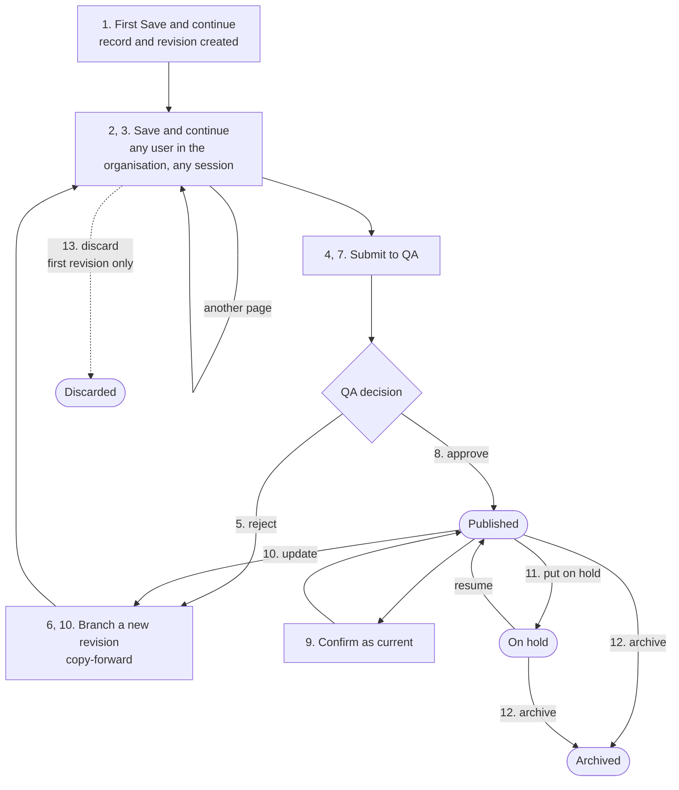
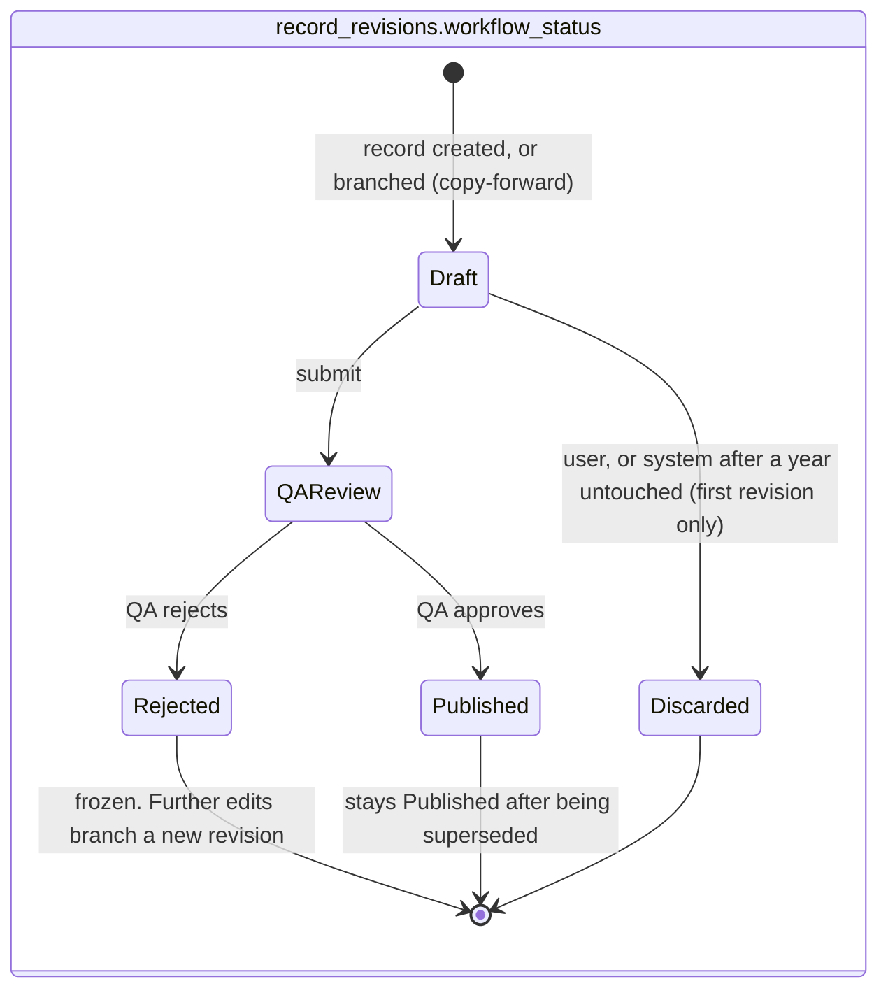
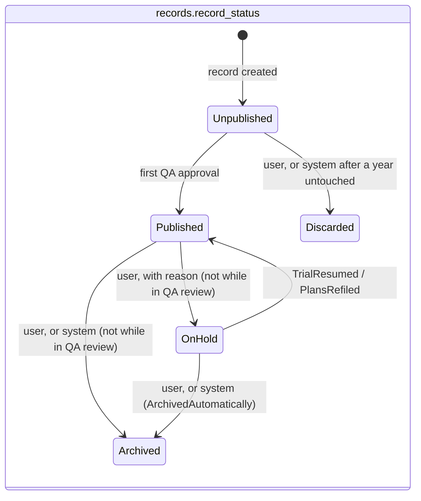
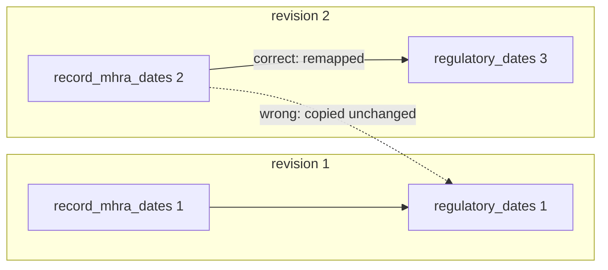

# Record lifecycle: what is written at each stage

Follows one medicine record from its first save to archive, then a second record that is discarded before it is ever submitted. Each stage gives a short explanation of what the user does, then every row inserted or updated, table by table.

**Contents**

- [Overview](#overview)
- [Conventions](#conventions)
- [Stage 1: First Save and continue on a brand new record](#stage-1-first-save-and-continue-on-a-brand-new-record)
- [Stage 2: Further saves in the same session](#stage-2-further-saves-in-the-same-session)
- [Stage 3: A colleague continues in a separate session](#stage-3-a-colleague-continues-in-a-separate-session)
- [Stage 4: Submit to QA](#stage-4-submit-to-qa)
- [Stage 5: QA rejects](#stage-5-qa-rejects)
- [Stage 6: Pharma user edits after rejection](#stage-6-pharma-user-edits-after-rejection)
- [Stage 7: Resubmit to QA](#stage-7-resubmit-to-qa)
- [Stage 8: QA approves](#stage-8-qa-approves)
- [Stage 9: Confirm as current](#stage-9-confirm-as-current)
- [Stage 10: Update a published record](#stage-10-update-a-published-record)
- [Stage 11: Put on hold](#stage-11-put-on-hold)
- [Stage 12: Archive](#stage-12-archive)
- [Stage 13: Discard a draft record](#stage-13-discard-a-draft-record)
- [Gotchas index](#gotchas-index)

## Overview

### The lifecycle at a glance

Numbers refer to the stages outlined below. A new revision is branched, and its content copied forward, in two places: after a QA rejection and when a published record is updated. Both lead back into the same editing loop.

 

### Status models

Two axes: `record_revisions.workflow_status` (per revision) and `records.record_status` (per record). Each moves through its own states, but not every pairing is allowed. [Status management](status-management.md) covers which pairings can coexist, the transitions between them, and the actions and display status for each.

 

---

 

## Conventions

### Mock users

3 mock users are referenced throughout this example walkthrough - a QA user (ID 15), and 2 users from the same organisation.

| `app_user.id` | Role |
| --- | --- |
| 7 | Pharma user who creates the record |
| 9 | Pharma colleague of user 7 |
| 15 | QA user |

 

### Reading the tables

Each table shows one row per database row written, with every column.

- **Inserted** rows show the values written.
- **Updated** rows show the whole existing row, with each changed value as ~~old~~ new. Only those columns are written, and the rest of the row is untouched.

Enum columns store integers, but the tables show the member name in snake_case (for example `record_status` `unpublished` = 0).

 

### Rules that apply at every stage

- Every save inserts one audit row per field whose value changed. Unchanged fields get no row, a save that changes nothing writes no rows, and rows are never updated.
- `old_value` is the value in the database at save time, not the value the client loaded.
- `NULL` means "not answered" and `unknown` is an answer, so `NULL → unknown` is a change and gets a row.
- A copy-forward writes **no** audit rows. Every audit row on a revision is therefore an edit made on that revision.

 

---

 

## Stage 1: First Save and continue on a brand new record

A pharma user (7) opens the "Add new record" form, completes the first page (product details) and clicks "Save and continue". Everything below is written in one transaction.

**`records`** is inserted:

| id | organisation_id | record_type | record_status | created_at | created_by | reviewed_at |
| --- | --- | --- | --- | --- | --- | --- |
| 1 | 42 | `medicine` | `unpublished` | 2026-01-10T09:00:00Z | 7 | NULL |

**`record_revisions`** is inserted:

| id | record_id | based_on_revision_id | workflow_status | created_by | created_at |
| --- | --- | --- | --- | --- | --- |
| 1 | 1 | NULL | `draft` | 7 | 2026-01-10T09:00:00Z |

**`record_product_details`**, the first section sub-table, is inserted with `revision_id` 1:

| id | revision_id | company_code | branded_name | record_title |
| --- | --- | --- | --- | --- |
| 1 | 1 | ACM-0042 | NULL | Chronic hepatitis C in adults |

**`record_names_and_identifiers`** is inserted with `record_product_detail_id` 1:

| id | record_product_detail_id | name | name_type | display_order |
| --- | --- | --- | --- | --- |
| 1 | 1 | ledipasvir | `generic_name` | 1 |
| 2 | 1 | sofosbuvir | `generic_name` | 2 |
| 3 | 1 | PF-04965842 | `other_identifier` | 1 |

> [!WARNING]
> This table is keyed to `record_product_detail_id`, not `revision_id`. Any query or copy that filters content by `revision_id` alone will miss it.

**`record_events`** is inserted:

| id | record_id | revision_id | qa_review_id | event_type | performed_by | performed_at | note | payload |
| --- | --- | --- | --- | --- | --- | --- | --- | --- |
| 1 | 1 | 1 | NULL | `record_created` | 7 | 2026-01-10T09:00:00Z | NULL | NULL |

> [!NOTE]
> This is the only event at this stage. The first revision is covered by `record_created` with `revision_id` set, and there is no separate `revision_created` event.

**`record_status_histories`** is inserted:

| id | record_id | from_status | to_status | reason | note | updated_by | updated_at |
| --- | --- | --- | --- | --- | --- | --- | --- |
| 1 | 1 | NULL | `unpublished` | NULL | NULL | 7 | 2026-01-10T09:00:00Z |

**`record_field_audit`** is inserted:

| id | record_id | revision_id | field_path | old_value | new_value | changed_by | changed_at |
| --- | --- | --- | --- | --- | --- | --- | --- |
| 1 | 1 | 1 | `record_product_detail.company_code` | NULL | `ACM-0042` | 7 | 2026-01-10T09:00:00Z |
| 2 | 1 | 1 | `record_product_detail.record_title` | NULL | `Chronic hepatitis C in adults` | 7 | 2026-01-10T09:00:00Z |
| 3 | 1 | 1 | `record_names_and_identifiers` | NULL | `{"generic_name": ["ledipasvir", "sofosbuvir"], "other_identifier": ["PF-04965842"]}` | 7 | 2026-01-10T09:00:00Z |

> [!NOTE]
> Only fields that changed are audited. `branded_name` went from NULL to NULL, so it has no row. When a page holds several questions, only the ones that changed get rows.

> [!WARNING]
> - `record_id` is denormalised from the revision and must be set explicitly.
> - Serialise JSON values canonically: fixed key order, and arrays in `display_order` or sorted. Otherwise identical collections serialise differently, and spurious changes get audited.
> - Insert order is records → record_revisions → record_product_details → record_names_and_identifiers. EF handles this through navigations, but raw SQL or bulk inserts must follow the same order.

 

---

 

## Stage 2: Further saves in the same session

The same user carries on through the form, clicking "Save and continue" on each page:

1. **09:12 Indication page.** Writes `medicines_indication_details` and the therapeutic areas junction for the first time.
2. **09:25 Regulatory and HTA page.** Writes two `regulatory_dates` rows, then `record_mhra_dates` and `record_htas`, which point at them.
3. **09:31 Back to the Indication page** to fix a typo in the presentation.

Everything stays on revision 1. Each section table has a unique index on `revision_id`, so the first save of a page inserts and later saves update the same row.

 

### Save 1: Indication page (09:12)

**`medicines_indication_details`** is inserted:

| id | revision_id | indication | bnf_chapter_id | indication_is_paediatric | indication_is_cancer | indication_is_rare_disease | formulation_type_id | presentation | mode_of_action | proposed_dose_regimen | is_personalised_medicine | medicine_technology_status |
| --- | --- | --- | --- | --- | --- | --- | --- | --- | --- | --- | --- | --- |
| 1 | 1 | Chronic hepatitis C virus infection in adults | 5 | `exclusively_adults` | `no` | `no` | 3 | 90 mg / 400 mg flim-coated tablet | NULL | NULL | NULL | 2 (`new_chemical_or_biological_entity`) |

> [!WARNING]
> - `medicine_technology_status` is a flags enum: several values are stored as a bitmask in one int column.
> - `is_personalised_medicine` was left unanswered, so it stays NULL. A non-nullable C# property would default to 0 and silently record `unknown`.

**`medicines_indication_detail_therapeutic_areas`** is inserted:

| medicines_indication_detail_id | therapeutic_area_id |
| --- | --- |
| 1 | 14 |

> [!WARNING]
> This junction table has a composite PK and no `id`, and it hangs off `medicines_indication_detail_id`. Save it by diffing the set: insert the added IDs and delete the removed ones.

**`record_field_audit`** is inserted (all `record_id` 1, `revision_id` 1, `changed_by` 7, `changed_at` 2026-01-10T09:12:00Z):

| id | field_path | old_value | new_value |
| --- | --- | --- | --- |
| 4 | `medicines_indication_detail.indication` | NULL | `Chronic hepatitis C virus infection in adults` |
| 5 | `medicines_indication_detail.bnf_chapter_id` | NULL | `5` |
| 6 | `medicines_indication_detail.indication_is_paediatric` | NULL | `exclusively_adults` |
| 7 | `medicines_indication_detail.indication_is_cancer` | NULL | `no` |
| 8 | `medicines_indication_detail.indication_is_rare_disease` | NULL | `no` |
| 9 | `medicines_indication_detail.formulation_type_id` | NULL | `3` |
| 10 | `medicines_indication_detail.presentation` | NULL | `90 mg / 400 mg flim-coated tablet` |
| 11 | `medicines_indication_detail.medicine_technology_status` | NULL | `["new_chemical_or_biological_entity"]` |
| 12 | `medicines_indication_detail_therapeutic_areas` | NULL | `{"therapeutic_area_id": [14]}` |

 

### Save 2: Regulatory and HTA page (09:25)

**`regulatory_dates`** is inserted first, because the next two tables reference it:

| id | revision_id | date_event | date_precision | date_value | is_confidential |
| --- | --- | --- | --- | --- | --- |
| 1 | 1 | `uk_submission` | `estimated_quarter` | 2026-07-01 | false |
| 2 | 1 | `uk_launch` | `estimated_month` | 2027-04-01 | **true** |

**`record_mhra_dates`** is inserted:

| id | revision_id | uk_submission_date_id | uk_licence_date_id | uk_conditional_approval_anticipated |
| --- | --- | --- | --- | --- |
| 1 | 1 | 1 | NULL | `unknown` |

**`record_htas`** is inserted:

| id | revision_id | vaccine_hta_assessor | medicine_hta_submission_intended | medicine_hta_bodies | hta_additional_details | hta_nice_aligned_pathway | nice_ta_development_id | uk_launch_date_id |
| --- | --- | --- | --- | --- | --- | --- | --- | --- |
| 1 | 1 | NULL | `yes` | 3 (`nice`, `smc`) | NULL | `unknown` | NULL | 2 |

> [!WARNING]
> - **Clearing a date.** FKs to `regulatory_dates` are `ON DELETE RESTRICT`, so null the FK first, then delete the date row.
> - **Dependent fields.** `medicine_hta_bodies` only applies when `medicine_hta_submission_intended` is `yes`. If that is later changed to `no`, the save must clear the bodies too, and the clearing gets its own audit row.
> - **Columns that don't apply.** `record_htas` is shared by medicines and vaccines, so `vaccine_hta_assessor` stays NULL here.

**`record_field_audit`** is inserted (`record_id` 1, `revision_id` 1, `changed_by` 7, `changed_at` 2026-01-10T09:25:00Z):

| id | field_path | old_value | new_value |
| --- | --- | --- | --- |
| 13 | `record_mhra_date.uk_submission_date` | NULL | `{"date_precision": "estimated_quarter", "date_value": "2026-07-01", "is_confidential": false}` |
| 14 | `record_mhra_date.uk_conditional_approval_anticipated` | NULL | `unknown` |
| 15 | `record_hta.medicine_hta_submission_intended` | NULL | `yes` |
| 16 | `record_hta.medicine_hta_bodies` | NULL | `["nice", "smc"]` |
| 17 | `record_hta.hta_nice_aligned_pathway` | NULL | `unknown` |
| 18 | `record_hta.uk_launch_date` | NULL | `{"date_precision": "estimated_month", "date_value": "2027-04-01", "is_confidential": true}` |

> [!NOTE]
> Date audit values hold the date's contents, never its `regulatory_dates.id`, because that ID changes on every copy-forward.

 

### Save 3: back to the Indication page (09:31)

**`medicines_indication_details`** is updated in place:

| id | revision_id | indication | bnf_chapter_id | indication_is_paediatric | indication_is_cancer | indication_is_rare_disease | formulation_type_id | presentation | mode_of_action | proposed_dose_regimen | is_personalised_medicine | medicine_technology_status |
| --- | --- | --- | --- | --- | --- | --- | --- | --- | --- | --- | --- | --- |
| 1 | 1 | Chronic hepatitis C virus infection in adults | 5 | `exclusively_adults` | `no` | `no` | 3 | ~~90 mg / 400 mg flim-coated tablet~~ 90 mg / 400 mg film-coated tablet | NULL | NULL | NULL | 2 (`new_chemical_or_biological_entity`) |

**`record_field_audit`** is inserted:

| id | record_id | revision_id | field_path | old_value | new_value | changed_by | changed_at |
| --- | --- | --- | --- | --- | --- | --- | --- |
| 19 | 1 | 1 | `medicines_indication_detail.presentation` | `90 mg / 400 mg flim-coated tablet` | `90 mg / 400 mg film-coated tablet` | 7 | 2026-01-10T09:31:00Z |

> [!WARNING]
> `presentation` now has two audit rows on revision 1 (10 and 19). A diff must net each field (first `old_value`, last `new_value`) and drop fields whose net change is nothing. Order by `changed_at, id`, because all rows from one save share a timestamp.

 

---

 

## Stage 3: A colleague continues in a separate session

Two days later a colleague (9) opens the same draft. They add AWMSG as an HTA body, move the estimated launch month (14:05), then fill in the clinical trials page for the first time (14:20).

It is still revision 1, because sessions and users don't create revisions. Existing section rows are updated and new sections are inserted. The only sign that someone else made these edits is `changed_by` on the audit rows.

 

### Save 1: Regulatory and HTA page (14:05)

**`record_htas`** is updated in place:

| id | revision_id | vaccine_hta_assessor | medicine_hta_submission_intended | medicine_hta_bodies | hta_additional_details | hta_nice_aligned_pathway | nice_ta_development_id | uk_launch_date_id |
| --- | --- | --- | --- | --- | --- | --- | --- | --- |
| 1 | 1 | NULL | `yes` | ~~3 (`nice`, `smc`)~~ 7 (`nice`, `smc`, `awmsg`) | NULL | `unknown` | NULL | 2 |

**`regulatory_dates`** is updated in place (the precision is unchanged, so the FK on `record_htas` stays the same):

| id | revision_id | date_event | date_precision | date_value | is_confidential |
| --- | --- | --- | --- | --- | --- |
| 2 | 1 | `uk_launch` | `estimated_month` | ~~2027-04-01~~ 2027-05-01 | **true** |

**`record_field_audit`** is inserted (`record_id` 1, `revision_id` 1, `changed_by` **9**, `changed_at` 2026-01-12T14:05:00Z):

| id | field_path | old_value | new_value |
| --- | --- | --- | --- |
| 20 | `record_hta.medicine_hta_bodies` | `["nice", "smc"]` | `["nice", "smc", "awmsg"]` |
| 21 | `record_hta.uk_launch_date` | `{"date_precision": "estimated_month", "date_value": "2027-04-01", "is_confidential": true}` | `{"date_precision": "estimated_month", "date_value": "2027-05-01", "is_confidential": true}` |

> [!WARNING]
> - **`old_value` comes from the database.** It is user 7's persisted value, so compute it on the server inside the save transaction.
> - **"Last edited by" comes from the audit.** `record_revisions` has no `updated_by` / `updated_at`, so use the latest `record_field_audit` row for the revision.

 

### Save 2: Clinical trials page (14:20)

**`record_clinical_trial_information`** is inserted:

| id | revision_id | recruiting_in_uk |
| --- | --- | --- |
| 1 | 1 | `yes` |

**`record_clinical_trials`** is inserted (one-to-many by `revision_id`, with no unique index):

| id | revision_id | study_name | clinical_trials_gov_number | trial_phase | brief_description |
| --- | --- | --- | --- | --- | --- |
| 1 | 1 | ION-UK | NCT06123456 | `phase_iii` | Open-label study of 12 weeks' treatment in treatment-naive adults |

**`other_clinical_trial_numbers`** is inserted with `clinical_trial_id` 1:

| id | clinical_trial_id | other_registry_number | display_order |
| --- | --- | --- | --- |
| 1 | 1 | 2025-001234-56 | 1 |
| 2 | 1 | ISRCTN12345678 | 2 |

**`record_field_audit`** is inserted (`record_id` 1, `revision_id` 1, `changed_by` 9, `changed_at` 2026-01-12T14:20:00Z):

| id | field_path | old_value | new_value |
| --- | --- | --- | --- |
| 22 | `record_clinical_trial_information.recruiting_in_uk` | NULL | `yes` |
| 23 | `record_clinical_trials` | NULL | `{"NCT06123456": {"study_name": "ION-UK", "trial_phase": "phase_iii", "brief_description": "Open-label study of 12 weeks' treatment in treatment-naive adults", "other_registry_numbers": ["2025-001234-56", "ISRCTN12345678"]}}` |

> [!NOTE]
> The trials collection, with the grandchild registry numbers nested inside it, is one JSON object keyed by NCT number, so the diff can match trials across revisions even though their PKs change. If a user edits the NCT number itself, the diff shows one trial removed and one added.

 

---

 

## Stage 4: Submit to QA

User 7 submits revision 1.

**`record_revisions`** is updated:

| id | record_id | based_on_revision_id | workflow_status | created_by | created_at |
| --- | --- | --- | --- | --- | --- |
| 1 | 1 | NULL | ~~`draft`~~ `qa_review` | 7 | 2026-01-10T09:00:00Z |

**`qa_reviews`** is inserted, pending:

| id | revision_id | outcome | note | reviewed_by | reviewed_at |
| --- | --- | --- | --- | --- | --- |
| 1 | 1 | NULL | NULL | NULL | NULL |

**`record_events`** is inserted:

| id | record_id | revision_id | qa_review_id | event_type | performed_by | performed_at | note | payload |
| --- | --- | --- | --- | --- | --- | --- | --- | --- |
| 2 | 1 | 1 | 1 | `submitted_to_qa` | 7 | 2026-01-13T10:00:00Z | NULL | NULL |

> [!WARNING]
> - **Read-only is app-enforced.** Nothing in the database stops writes to a `qa_review` revision's content, so every save path must check `workflow_status = draft`.
> - **Validation.** Drafts may be incomplete, so required-field validation belongs here rather than on save. Section columns that are `NOT NULL` (e.g. `medicines_treatment_details.proposed_place_in_therapy`) mean that row can't be inserted until the field is filled.

For this first round the QA diff is every netted audit row on revision 1. It has no `based_on_revision_id`, so every field shows as new.

 

---

 

## Stage 5: QA rejects

The QA user (15) rejects revision 1 with the note *"Public pipeline shows UK submission in Q2 2026, please confirm. Please also add Gastroenterology as a therapeutic area."*

**`qa_reviews`** is updated:

| id | revision_id | outcome | note | reviewed_by | reviewed_at |
| --- | --- | --- | --- | --- | --- |
| 1 | 1 | ~~NULL~~ `rejected` | ~~NULL~~ Public pipeline shows UK submission in Q2 2026… | ~~NULL~~ 15 | ~~NULL~~ 2026-01-15T11:30:00Z |

**`record_revisions`** is updated:

| id | record_id | based_on_revision_id | workflow_status | created_by | created_at |
| --- | --- | --- | --- | --- | --- |
| 1 | 1 | NULL | ~~`qa_review`~~ `rejected` | 7 | 2026-01-10T09:00:00Z |

**`record_events`** is inserted:

| id | record_id | revision_id | qa_review_id | event_type | performed_by | performed_at | note | payload |
| --- | --- | --- | --- | --- | --- | --- | --- | --- |
| 3 | 1 | 1 | 1 | `revision_rejected` | 15 | 2026-01-15T11:30:00Z | NULL | NULL |

> [!WARNING]
> - **Frozen.** Revision 1 is now frozen permanently and never returns to `draft`.
> - **`records.reviewed_at` is not touched.** Rejection doesn't confirm the record is current.
> - **One home for the note.** Keep it in `qa_reviews.note` only, rather than copying it into `record_events.note`, so the two can't drift.

 

---

 

## Stage 6: Pharma user edits after rejection

User 7 opens the rejected record to make QA's changes. This branches a new **revision 2** from revision 1, and every section row is **copied forward** with new PKs (08:45). They then make the two edits QA asked for (08:58).

 

### Branch and copy-forward (08:45)

**`record_revisions`** is inserted:

| id | record_id | based_on_revision_id | workflow_status | created_by | created_at |
| --- | --- | --- | --- | --- | --- |
| 2 | 1 | **1** | `draft` | 7 | 2026-01-16T08:45:00Z |

**Copy-forward.** Every row is inserted with the same values as revision 1 except its PK and the FKs shown:

| Table | Revision 1 rows | Revision 2 rows | FKs remapped |
| --- | --- | --- | --- |
| record_product_details | 1 | 2 | `revision_id` → 2 |
| record_names_and_identifiers | 1, 2, 3 | 4, 5, 6 | `record_product_detail_id` → 2 |
| medicines_indication_details | 1 | 2 | `revision_id` → 2 |
| medicines_indication_detail_therapeutic_areas | (1, 14) | (2, 14) | `medicines_indication_detail_id` → 2 |
| regulatory_dates | 1, 2 | 3, 4 | `revision_id` → 2 |
| record_mhra_dates | 1 | 2 | `revision_id` → 2, `uk_submission_date_id` 1 → **3** |
| record_htas | 1 | 2 | `revision_id` → 2, `uk_launch_date_id` 2 → **4** |
| record_clinical_trial_information | 1 | 2 | `revision_id` → 2 |
| record_clinical_trials | 1 | 2 | `revision_id` → 2 |
| other_clinical_trial_numbers | 1, 2 | 3, 4 | `clinical_trial_id` → 2 |

The date FKs are the part most likely to go wrong:

> [!WARNING]
> - **Remap date FKs.** If the FK is copied unchanged it still points at revision 1's date, and the database can't catch it because that date row is valid, just on the wrong revision. The same applies to every FK to `regulatory_dates` (`record_htas`, `medicines_eams_pims`, `medicines_eu_statuses`, `medicines_global_submissions`, `medicines_intl_recognitions`). Add a check that every date FK on revision N points at a date with `revision_id = N`.
> - **Copy child and junction rows under their new parents.** Names go under product detail 2, therapeutic areas under indication detail 2, and registry numbers under trial 2.
> - **Cover every table.** When a section table is added, the copy-forward must be updated too. A test should assert that every table owned by a revision (directly or through a parent) is copied, for both medicines and vaccines.

**`record_events`** is inserted:

| id | record_id | revision_id | qa_review_id | event_type | performed_by | performed_at | note | payload |
| --- | --- | --- | --- | --- | --- | --- | --- | --- |
| 4 | 1 | 2 | NULL | `revision_created` | 7 | 2026-01-16T08:45:00Z | NULL | `{"copy_forward_from_revision_id": 1}` |

> [!NOTE]
> The event is the only marker of the copy-forward. No audit rows are written, so revision 2's audit rows will be exactly the post-rejection edits, which is what QA needs to review in round 2.

 

### Edits (08:58)

**`regulatory_dates`** is updated in place, on the copied-forward row:

| id | revision_id | date_event | date_precision | date_value | is_confidential |
| --- | --- | --- | --- | --- | --- |
| 3 | 2 | `uk_submission` | `estimated_quarter` | ~~2026-07-01~~ 2026-04-01 | false |

**`medicines_indication_detail_therapeutic_areas`** is inserted:

| medicines_indication_detail_id | therapeutic_area_id |
| --- | --- |
| 2 | 22 |

**`record_field_audit`** is inserted (`record_id` 1, `revision_id` **2**, `changed_by` 7, `changed_at` 2026-01-16T08:58:00Z):

| id | field_path | old_value | new_value |
| --- | --- | --- | --- |
| 24 | `record_mhra_date.uk_submission_date` | `{"date_precision": "estimated_quarter", "date_value": "2026-07-01", "is_confidential": false}` | `{"date_precision": "estimated_quarter", "date_value": "2026-04-01", "is_confidential": false}` |
| 25 | `medicines_indication_detail_therapeutic_areas` | `{"therapeutic_area_id": [14]}` | `{"therapeutic_area_id": [14, 22]}` |

 

---

 

## Stage 7: Resubmit to QA

The same writes as [stage 4](#stage-4-submit-to-qa), on revision 2:

- `record_revisions` 2: `workflow_status` changes from `draft` to `qa_review`.
- `qa_reviews` 2 is inserted, pending, with `revision_id` 2.
- `record_events` 5 is inserted: `submitted_to_qa`, `revision_id` 2, `qa_review_id` 2, `performed_by` 7, `performed_at` 2026-01-16T09:10:00Z.

The QA diff for this round is the netted audit rows on revision 2: rows 24 and 25. QA can show the previous rejection note by following `based_on_revision_id` 1 to `qa_reviews` 1.

 

---

 

## Stage 8: QA approves

The QA user approves revision 2, and the record is published for the first time.

**`qa_reviews`** is updated:

| id | revision_id | outcome | note | reviewed_by | reviewed_at |
| --- | --- | --- | --- | --- | --- |
| 2 | 2 | ~~NULL~~ `approved` | NULL | ~~NULL~~ 15 | ~~NULL~~ 2026-01-19T15:00:00Z |

**`record_revisions`** is updated:

| id | record_id | based_on_revision_id | workflow_status | created_by | created_at |
| --- | --- | --- | --- | --- | --- |
| 2 | 1 | 1 | ~~`qa_review`~~ `published` | 7 | 2026-01-16T08:45:00Z |

**`records`** is updated:

| id | organisation_id | record_type | record_status | created_at | created_by | reviewed_at |
| --- | --- | --- | --- | --- | --- | --- |
| 1 | 42 | `medicine` | ~~`unpublished`~~ `published` | 2026-01-10T09:00:00Z | 7 | ~~NULL~~ 2026-01-16T09:10:00Z |

> [!WARNING]
> `reviewed_at` is the **submission** time (the `performed_at` of `submitted_to_qa` event 5), not the approval time. Because a rejection always branches a new revision, each revision has exactly one `submitted_to_qa` event, so the lookup is unambiguous. Next review due: medicine + published = `reviewed_at` + 3 months.

**`record_status_histories`** is inserted:

| id | record_id | from_status | to_status | reason | note | updated_by | updated_at |
| --- | --- | --- | --- | --- | --- | --- | --- |
| 2 | 1 | `unpublished` | `published` | NULL | NULL | 15 | 2026-01-19T15:00:00Z |

**`record_events`** is inserted:

| id | record_id | revision_id | qa_review_id | event_type | performed_by | performed_at | note | payload |
| --- | --- | --- | --- | --- | --- | --- | --- | --- |
| 6 | 1 | 2 | 2 | `record_published` | 15 | 2026-01-19T15:00:00Z | NULL | NULL |

> [!NOTE]
> Only one event is written, `record_published`. There is no extra `record_status_changed`, even though a status history row is written. This follows a general rule:
> - Every `record_status_histories` row has exactly one event. It is `record_status_changed`, unless the status change is a side effect of a more specific event (`record_created` in [stage 1](#stage-1-first-save-and-continue-on-a-brand-new-record), `record_published` here).
> - Every `record_status_changed` event has exactly one `record_status_histories` row.

 

---

 

## Stage 9: Confirm as current

Three months later user 9 confirms nothing has changed. No revision, QA review or audit row is involved.

**`records`** is updated:

| id | organisation_id | record_type | record_status | created_at | created_by | reviewed_at |
| --- | --- | --- | --- | --- | --- | --- |
| 1 | 42 | `medicine` | `published` | 2026-01-10T09:00:00Z | 7 | ~~2026-01-16T09:10:00Z~~ 2026-04-14T10:00:00Z |

**`record_events`** is inserted:

| id | record_id | revision_id | qa_review_id | event_type | performed_by | performed_at | note | payload |
| --- | --- | --- | --- | --- | --- | --- | --- | --- |
| 7 | 1 | 2 | NULL | `record_reviewed_no_change` | 9 | 2026-04-14T10:00:00Z | NULL | NULL |

> [!NOTE]
> `revision_id` is the currently published revision, which records which content was confirmed.

 

---

 

## Stage 10: Update a published record

The UK submission has now happened, so user 9 updates the record. A new **revision 3** is branched from revision 2 and copied forward exactly as in [stage 6](#stage-6-pharma-user-edits-after-rejection): `regulatory_dates` 3 and 4 become 5 and 6, and `record_mhra_dates` 3 and `record_htas` 3 are remapped to them. `record_events` 8 (`revision_created`, `revision_id` 3) is inserted. Then the user edits (09:05).

**`regulatory_dates`** is updated in place, changing precision as well as value:

| id | revision_id | date_event | date_precision | date_value | is_confidential |
| --- | --- | --- | --- | --- | --- |
| 5 | 3 | `uk_submission` | ~~`estimated_quarter`~~ `actual_date` | ~~2026-04-01~~ 2026-06-23 | false |

**`record_mhra_dates`** is updated in place:

| id | revision_id | uk_submission_date_id | uk_licence_date_id | uk_conditional_approval_anticipated |
| --- | --- | --- | --- | --- |
| 3 | 3 | 5 | NULL | ~~`unknown`~~ `no` |

**`record_field_audit`** is inserted (`record_id` 1, `revision_id` **3**, `changed_by` 9, `changed_at` 2026-06-29T09:05:00Z):

| id | field_path | old_value | new_value |
| --- | --- | --- | --- |
| 26 | `record_mhra_date.uk_submission_date` | `{"date_precision": "estimated_quarter", "date_value": "2026-04-01", "is_confidential": false}` | `{"date_precision": "actual_date", "date_value": "2026-06-23", "is_confidential": false}` |
| 27 | `record_mhra_date.uk_conditional_approval_anticipated` | `unknown` | `no` |

**Submission and approval** write the same rows as stages [7](#stage-7-resubmit-to-qa) and [8](#stage-8-qa-approves), on revision 3: `qa_reviews` 3, `record_events` 9 (`submitted_to_qa`, 2026-06-29T09:20:00Z) and `record_events` 10 (`record_published`, 2026-06-30T13:00:00Z). The differences from the first publication:

> [!WARNING]
> - **No status change.** `records.record_status` is already `published`, so only `reviewed_at` changes (to 2026-06-29T09:20:00Z) and **no status history row** is written. Don't call `Record.ChangeStatus` with the current status, or it writes a `published → published` row.
> - **Superseded revisions stay published.** Revision 2 keeps `workflow_status` `published`, because there is no superseded status. The "current published revision" is the latest `published` revision by `id`, not the latest revision. While revision 3 is in `draft` or `qa_review`, horizon scanners still see revision 2.
> - **Publication diffs can span revisions.** The diff from revision 2 to 3 is the netted audit rows on revision 3. If revision 3 had been rejected and revision 4 approved, the diff would need the audit rows on both 3 **and** 4, found by walking `based_on_revision_id` back from the new published revision to the previous one.

 

---

 

## Stage 11: Put on hold

User 7 puts the record on hold because the trial is paused.

**`records`** is updated:

| id | organisation_id | record_type | record_status | created_at | created_by | reviewed_at |
| --- | --- | --- | --- | --- | --- | --- |
| 1 | 42 | `medicine` | ~~`published`~~ `on_hold` | 2026-01-10T09:00:00Z | 7 | ~~2026-06-29T09:20:00Z~~ 2026-09-01T16:00:00Z |

**`record_status_histories`** is inserted:

| id | record_id | from_status | to_status | reason | note | updated_by | updated_at |
| --- | --- | --- | --- | --- | --- | --- | --- |
| 3 | 1 | `published` | `on_hold` | `trial_suspended` | ION-UK paused pending safety review | 7 | 2026-09-01T16:00:00Z |

**`record_events`** is inserted:

| id | record_id | revision_id | qa_review_id | event_type | performed_by | performed_at | note | payload |
| --- | --- | --- | --- | --- | --- | --- | --- | --- |
| 11 | 1 | NULL | NULL | `record_status_changed` | 7 | 2026-09-01T16:00:00Z | NULL | NULL |

> [!WARNING]
> - **Revisions are untouched.** Revision 3 stays `published` while the record is `on_hold`. `workflow_status` and `record_status` are separate columns, so check the right one.
> - **Status rules.** A record can't be put on hold while its latest revision is in QA review, and while on hold no revision can be created, edited or submitted. See [status management](status-management.md).
> - **The history row is the source of truth.** The event is record-level (`revision_id` NULL). From, to and reason live in `record_status_histories`, and the event is just the timeline entry.
> - **Review clock.** `reviewed_at` changes for a user-initiated status change. Next review due: medicine + on hold = `reviewed_at` + 6 months.
> - **Reasons depend on direction.** `trial_resumed` and `plans_refiled` are only valid for `on_hold → published`. This is checked by the app only.

 

---

 

## Stage 12: Archive

User 7 archives the record because development has been discontinued.

**`records`** is updated:

| id | organisation_id | record_type | record_status | created_at | created_by | reviewed_at |
| --- | --- | --- | --- | --- | --- | --- |
| 1 | 42 | `medicine` | ~~`on_hold`~~ `archived` | 2026-01-10T09:00:00Z | 7 | ~~2026-09-01T16:00:00Z~~ 2026-10-01T12:00:00Z |

**`record_status_histories`** is inserted:

| id | record_id | from_status | to_status | reason | note | updated_by | updated_at |
| --- | --- | --- | --- | --- | --- | --- | --- |
| 4 | 1 | `on_hold` | `archived` | `development_discontinued` | NULL | 7 | 2026-10-01T12:00:00Z |

**`record_events`** is inserted:

| id | record_id | revision_id | qa_review_id | event_type | performed_by | performed_at | note | payload |
| --- | --- | --- | --- | --- | --- | --- | --- | --- |
| 12 | 1 | NULL | NULL | `record_status_changed` | 7 | 2026-10-01T12:00:00Z | NULL | NULL |

> [!WARNING]
> - **Automatic archive.** When the system archives a record, `updated_by` and `performed_by` are NULL, `reason` is `archived_automatically`, and `reviewed_at` is **not** touched.
> - **Status rules.** A record can't be archived while its latest revision is in QA review, and a draft left on an archived record stays `draft` forever. See [status management](status-management.md).

 

---

 

## Stage 13: Discard a draft record

A record can be discarded only while it has a single revision that is still in `draft`, which means it has never been submitted or published. Any user in the organisation can discard it. Discarding sets both the revision and the record to `discarded`. Nothing is deleted.

This stage follows a second record (2). User 7 created it on 2026-03-02 with revision 4, as in [stage 1](#stage-1-first-save-and-continue-on-a-brand-new-record) (`record_events` 13, `record_status_histories` 5), and never submitted it. They now discard it.

**`record_revisions`** is updated:

| id | record_id | based_on_revision_id | workflow_status | created_by | created_at |
| --- | --- | --- | --- | --- | --- |
| 4 | 2 | NULL | ~~`draft`~~ `discarded` | 7 | 2026-03-02T10:00:00Z |

**`records`** is updated:

| id | organisation_id | record_type | record_status | created_at | created_by | reviewed_at |
| --- | --- | --- | --- | --- | --- | --- |
| 2 | 42 | `medicine` | ~~`unpublished`~~ `discarded` | 2026-03-02T10:00:00Z | 7 | NULL |

**`record_status_histories`** is inserted:

| id | record_id | from_status | to_status | reason | note | updated_by | updated_at |
| --- | --- | --- | --- | --- | --- | --- | --- |
| 6 | 2 | `unpublished` | `discarded` | `manually_discarded` | NULL | 7 | 2026-03-20T15:00:00Z |

**`record_events`** is inserted:

| id | record_id | revision_id | qa_review_id | event_type | performed_by | performed_at | note | payload |
| --- | --- | --- | --- | --- | --- | --- | --- | --- |
| 14 | 2 | 4 | NULL | `record_status_changed` | 7 | 2026-03-20T15:00:00Z | NULL | NULL |

> [!NOTE]
> As in [stage 11](#stage-11-put-on-hold), the history row holds the from, to and reason, and the event is the timeline entry. Unlike on hold and archive, the event sets `revision_id`, because the revision changes status too.

 

### Automatic discard

When a draft first revision has been untouched for a year, the system discards it and writes the same rows, with these differences:

- `record_status_histories.reason` is `automatically_discarded`.
- `record_events.performed_by` and `record_status_histories.updated_by` are NULL.

> [!WARNING]
> - **"Unpublished" isn't enough.** Check that the record has exactly one revision and that it is `draft`. Record 1 was still `unpublished` during [stage 6](#stage-6-pharma-user-edits-after-rejection), with a `draft` revision 2, but it can't be discarded because its first revision was submitted and rejected.
> - **"Untouched" comes from the audit.** `record_revisions` has no `updated_at`, so the last activity is the latest `record_field_audit.changed_at` for the revision, or `record_revisions.created_at` if there are none.
> - **Both statuses change together.** Update the revision, the record, the history row and the event in one transaction, so a record is never left `discarded` with a `draft` revision, or the reverse.
> - **Terminal.** Nothing leads out of `discarded`. Saves are already blocked because every save path checks `workflow_status = draft`, but discarded records must also be filtered out of lists, searches and the review-due job.

 

---

 

## Gotchas index

| Gotcha | Stage |
| --- | --- |
| Child tables keyed to a parent row, not `revision_id` | [1](#stage-1-first-save-and-continue-on-a-brand-new-record), [3](#stage-3-a-colleague-continues-in-a-separate-session) |
| Canonical JSON serialisation for collection audit values | [1](#stage-1-first-save-and-continue-on-a-brand-new-record) |
| Flags enums stored as bitmasks | [2](#stage-2-further-saves-in-the-same-session) |
| NULL (unanswered) vs `unknown` (answered) | [2](#stage-2-further-saves-in-the-same-session) |
| Junction tables: composite PK, saved by set diff | [2](#stage-2-further-saves-in-the-same-session) |
| `regulatory_dates` insert and delete order (`RESTRICT` FKs) | [2](#stage-2-further-saves-in-the-same-session) |
| Clearing dependent fields produces audit rows | [2](#stage-2-further-saves-in-the-same-session) |
| Append-every-save audit needs netting, ordered by `changed_at, id` | [2](#stage-2-further-saves-in-the-same-session) |
| `old_value` from the database. "Last edited by" from the audit | [3](#stage-3-a-colleague-continues-in-a-separate-session) |
| Submitter and time only on the `submitted_to_qa` event | [4](#stage-4-submit-to-qa) |
| Read-only and one-open-revision rules not enforced in the database | [4](#stage-4-submit-to-qa) |
| `NOT NULL` section columns block partial drafts | [4](#stage-4-submit-to-qa) |
| Rejected revisions frozen. `reviewed_at` untouched on rejection | [5](#stage-5-qa-rejects) |
| Copy-forward must remap date FKs and cover every revision-owned table | [6](#stage-6-pharma-user-edits-after-rejection) |
| `reviewed_at` = submission time, not approval time | [8](#stage-8-qa-approves) |
| One event per status history row: `record_status_changed`, unless a side effect of `record_created` or `record_published` | [8](#stage-8-qa-approves) |
| Date precision change: in place vs new row (orphans) | [10](#stage-10-update-a-published-record) |
| No status history row when already published | [10](#stage-10-update-a-published-record) |
| Superseded revisions stay published. Current = latest published | [10](#stage-10-update-a-published-record) |
| Publication diff may span several revisions | [10](#stage-10-update-a-published-record) |
| `workflow_status` and `record_status` are separate, but not every pairing is allowed | [Status management](status-management.md), [11](#stage-11-put-on-hold) |
| No hold or archive while the latest revision is in QA review | [11](#stage-11-put-on-hold), [12](#stage-12-archive) |
| Automatic archive: NULL actor, `reviewed_at` untouched | [12](#stage-12-archive) |
| Discard eligibility: exactly one revision, still `draft` (not just `unpublished`) | [13](#stage-13-discard-a-draft-record) |
| "Untouched for a year" measured from the audit | [13](#stage-13-discard-a-draft-record) |
| Revision and record status change in one transaction. `discarded` is terminal | [13](#stage-13-discard-a-draft-record) |
