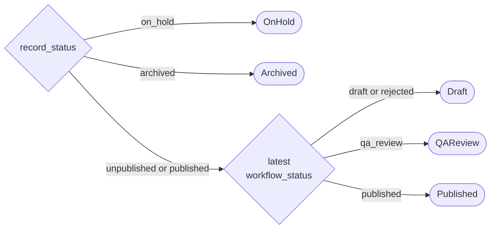

# Record status management

How a record's status and its latest revision's status combine: which pairings can exist, the transitions between them, the actions offered for each, and the status shown to users. For the rows written at each step, see the [record lifecycle](lifecycle.md).

**Contents**

- [The state](#the-state)
- [Allowed combinations](#allowed-combinations)
- [Transitions](#transitions)
- [Actions](#actions)
- [Display status](#display-status)

## The state

A record's state is the pair of:

- `records.record_status`
- the `record_revisions.workflow_status` of its **latest** revision (the most recently created)

The pair is enforced in code by `RecordLifecycleStateMachine`, which permits a command only from the states listed under [Transitions](#transitions). Earlier revisions are not part of the state, and a transition never changes them.

 

## Allowed combinations

| `record_status` ↓ / latest `workflow_status` → | `draft` | `qa_review` | `published` | `rejected` | `discarded` |
| --- | --- | --- | --- | --- | --- |
| `unpublished` | Yes | Yes | No | Yes | No |
| `published` | Yes | Yes | Yes | Yes | No |
| `on_hold` | Yes | No | Yes | Yes | No |
| `archived` | Yes | No | Yes | Yes | No |
| `discarded` | No | No | No | No | Yes |

- **QA review locks the record.** While the latest revision is `qa_review`, the record can't be put on hold or archived, by a user or the system, until QA approves or rejects it.
- **On hold and archived lock the revisions.** No revision can be created, edited or submitted. On hold, the only actions are confirming the hold, resuming to `published` and archiving.
- **A draft can be left behind.** A user may create a draft of a published record and then put the record on hold or archive it. The draft is kept, frozen. It can be continued once an on hold record is resumed, and stays `draft` forever on an archived one.
- **Some statuses change together.** The first QA approval sets the revision and the record to `published` in one transaction, and a discard sets both to `discarded`, so neither is ever seen half-done.
- **Archived and discarded are terminal.** No command is permitted from either.

 

## Transitions

In this table, *x* stands for `draft`, `published` or `rejected`, and the latest revision keeps that status through the transition.

| Command | From | To | Scenario |
| --- | --- | --- | --- |
| Submit | (`unpublished`, `draft`) | (`unpublished`, `qa_review`) | First submission, or resubmission after a rejection ([stages 4, 7](lifecycle.md#stage-4-submit-to-qa)) |
| Submit | (`published`, `draft`) | (`published`, `qa_review`) | Submitting an update to a published record ([stage 10](lifecycle.md#stage-10-update-a-published-record)) |
| Approve | (`unpublished`, `qa_review`) | (`published`, `published`) | First publication ([stage 8](lifecycle.md#stage-8-qa-approves)) |
| Approve | (`published`, `qa_review`) | (`published`, `published`) | An update is published ([stage 10](lifecycle.md#stage-10-update-a-published-record)) |
| Reject | (`unpublished`, `qa_review`) | (`unpublished`, `rejected`) | First submission rejected ([stage 5](lifecycle.md#stage-5-qa-rejects)) |
| Reject | (`published`, `qa_review`) | (`published`, `rejected`) | An update to a published record is rejected |
| CreateRevision | (`unpublished`, `rejected`) | (`unpublished`, `draft`) | Editing after a rejection ([stage 6](lifecycle.md#stage-6-pharma-user-edits-after-rejection)) |
| CreateRevision | (`published`, `published`) | (`published`, `draft`) | Updating a published record ([stage 10](lifecycle.md#stage-10-update-a-published-record)) |
| CreateRevision | (`published`, `rejected`) | (`published`, `draft`) | Editing after an update is rejected |
| PutOnHold | (`published`, *x*) | (`on_hold`, *x*) | [Stage 11](lifecycle.md#stage-11-put-on-hold) |
| Resume | (`on_hold`, *x*) | (`published`, *x*) | The trial resumes or plans are refiled |
| Archive | (`published`, *x*) or (`on_hold`, *x*) | (`archived`, *x*) | By a user, or automatically ([stage 12](lifecycle.md#stage-12-archive)) |
| Discard | (`unpublished`, `draft`) | (`discarded`, `discarded`) | First revision only, by a user or automatically ([stage 13](lifecycle.md#stage-13-discard-a-draft-record)) |

> [!WARNING]
> - **CreateRevision creates a new revision.** The `draft` in the new state is the new revision's status. The revision it was created from keeps its status, so a `rejected` revision stays `rejected`.
> - **Discard needs the first revision.** The pair can't show whether the latest revision is the first, so the caller checks that the record has exactly one revision before sending Discard.

 

### Commands that don't change status

These are permitted in some states but change neither status. They decide which actions are offered.

| Command | Permitted in |
| --- | --- |
| EditDraft | (`unpublished`, `draft`), (`published`, `draft`) |
| ConfirmCurrent | (`published`, *x*), (`on_hold`, *x*) |

 

## Actions

The record DTO returns `actions`, the list of `RecordAction` values the user can take, so the frontend doesn't work them out from the statuses. `Record.GetPermittedActions` maps each permitted command to an action:

| Command | Action |
| --- | --- |
| EditDraft, CreateRevision | `Update` |
| PutOnHold, Resume, Archive | `ChangeStatus` |
| ConfirmCurrent | `ConfirmCurrent`, or `ConfirmOnHold` when the record is on hold |
| Discard | `Discard`, only when the record has a single revision |
| Submit, Approve, Reject | None. These aren't offered on the record page |

`ViewTimeline` is always included. This gives:

| `record_status` | Latest `workflow_status` | Actions |
| --- | --- | --- |
| `unpublished` | `draft` | `Update`, `Discard` (single revision only), `ViewTimeline` |
| `unpublished` | `qa_review` | `ViewTimeline` |
| `unpublished` | `rejected` | `Update`, `ViewTimeline` |
| `published` | `draft`, `published` or `rejected` | `Update`, `ChangeStatus`, `ConfirmCurrent`, `ViewTimeline` |
| `published` | `qa_review` | `ViewTimeline` |
| `on_hold` | *x* | `ChangeStatus`, `ConfirmOnHold`, `ViewTimeline` |
| `archived` | *x* | `ViewTimeline` |

Discarded records aren't returned, so they have no actions.

 

## Display status

The display status for horizon scanners is the same as the `record_status` saved against the record in the database. Unpublished and discarded records aren't visible to them, and the latest revision's status is never shown. A record in the middle of an update is still `Published` to them, and they see the content of its latest `published` revision ([stage 10](lifecycle.md#stage-10-update-a-published-record)).

However, pharma users need to be able to see what stage of the lifecycle their most recent revision is at. The display status for them is determined according to the following:
 

In summary: on hold and archived records show their record status, otherwise the latest revision's status is shown, with a rejected revision shown as a draft because it is returned to the user to edit.

 
