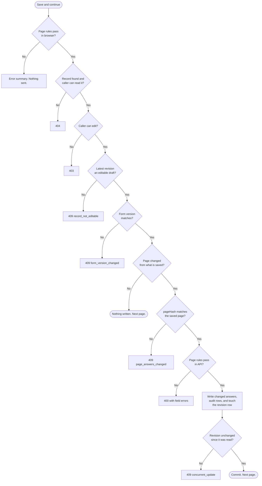
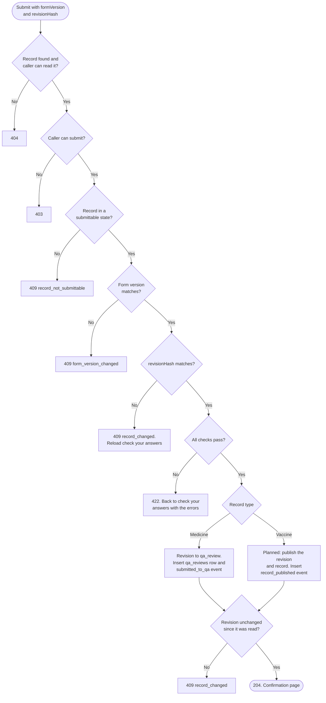

# Record validation and concurrency

How a record is validated, saved and submitted, and how two people editing the same record are kept from overwriting each other.

Sections marked **Planned** describe agreed behaviour that isn't built yet.

**Contents**

- [Summary](#summary)
- [Saving a page](#saving-a-page)
- [Cross-page rules](#cross-page-rules)
- [Check your answers and submit](#check-your-answers-and-submit)
- [Concurrency](#concurrency)
- [Hashing](#hashing)

## Summary

- **Saving a page.** Page rules (mandatory, format, and rules between fields on the page) are validated in both the browser and the API. The whole page is saved, not only the fields the user edited, because saving confirms everything on it. Saving a page with no changes writes nothing and always succeeds.
- **Concurrent saves.** A user can only overwrite answers they have seen. If anything on the page changed since it loaded, the save is blocked and the user reloads. Changes on other pages don't affect it, unless two saves land at the same moment (see [Concurrency](#concurrency)).
- **Cross-page rules** need answers from more than one page, for example "the commercial launch date must be on or after the licence date, unless the medicine is in EAMS". They never block a save, meaning a record draft can be in an inconsistent state. These must be resolved before submission to QA.
- **Check your answers** runs every page rule across the whole record, so unanswered questions are caught, and every cross-page rule. Errors appear in the error summary with links to the fields that fix them, and Submit is hidden until there are none.
- **Submitting** is blocked if anything in the record changed since check your answers loaded, so the record submitted is the record the user reviewed. All the checks run again, because date-based rules can change even when the answers haven't.

Changes the user hasn't seen are detected with a `pageHash` and a `revisionHash` (the whole revision), both calculated by the API (see [Hashing](#hashing)). Writes that overlap within a request are detected with the revision's `xmin` (see [Concurrency](#concurrency)).

 

## Saving a page

Every page save goes through one service and is written in one transaction. It saves to the record's latest revision, which must be a draft.

- **Editable** means [status management](status-management.md) permits editing the draft. A record isn't editable while its latest revision is in QA review, or while it is on hold, archived or discarded.
- **Saving without changes always succeeds.** If the submitted page matches what is saved, nothing is written, whatever pageHash was sent. A colleague who saved the same values, or a user who presses Save and continue twice, is never blocked.
- **One page, one hash.** A change on another page never makes the pageHash stale.
- **The pageHash is checked before the page rules.** A user with a stale page reloads straight away, rather than fixing field errors only to be told to reload.

**Planned: draft copy-forward.** Today a save needs the latest revision to be a draft, so a record whose latest revision is published or rejected returns `409 record_not_editable`. The plan is for the API to pick the target revision: the draft, or the latest published or rejected revision. The first save after a publication or rejection then creates the draft by copy-forward and writes the page to it.

### Single-question and multi-question pages

The flow is the same. On a page with several questions:

- page rules include the rules between fields on that page
- answers that no longer apply, on this page or any page that depends on it, are cleared in the same save, and each cleared answer gets its own audit row
- child rows, such as multi-select answers, are saved by set difference: rows for added values are inserted and rows for removed values are deleted
- a change to *any* field on the page blocks the save, even one this user didn't edit, because they are confirming the whole page

 

## Cross-page rules

Cross-page rules let users answer questions in any order without a correct answer ever being rejected. The content on each related page explains the rule, so users can (potentially) save a correct answer on a given page that breaks the rule, and then navigate to the other relevant page and update the answer there.

The medicine rules, from the medicines dataset, are defined in `MedicineCrossPageRules`. Each one is reported on both dates:

| Rule | Earlier date | Later date | Same day allowed |
| --- | --- | --- | --- |
| CR-01 | UK licence | UK commercial launch, unless the company will submit to EAMS | Yes |
| CR-02 | UK regulatory submission | UK licence | No |
| CR-03 | UK regulatory submission | UK commercial launch | No |
| CR-04 | International regulatory submission | International licence | No |
| CR-05 | Global first submission | UK regulatory submission | Yes |
| CR-06 | Global first submission | International regulatory submission | Yes |
| CR-07 | EAMS submission | EAMS scientific opinion | No |

A rule is skipped when either date doesn't apply, is unanswered or isn't a real date; the page rules report those.

Cross-page rules are checked when check your answers loads and prevent submission if the current answers are invalid. They are checked again on submission, meaning QA will only ever receive records that are consistent.

**Estimated dates are compared as ranges.** An exact date is one day, a month covers the month and a quarter covers the quarter. Launch is only "before" licence if its range ends before the licence range starts, so a launch of 15 August 2026 against a licence in Q3 2026 is valid.

 

## Check your answers and submit

Anyone in the organisation can edit the draft at any time, so a colleague may save a change after check your answers loaded. Without a check, Submit would send QA answers the submitter never saw, or for a vaccine, publish them.

The record submitted must be exactly the record the user reviewed. This is done with the revisionHash: a fingerprint of the whole revision, taken when check your answers loads. Submit sends it back with the form version, and the API recalculates it. If anything in the revision has changed, the submission is blocked with `409 record_changed`, and the user reloads check your answers to see the change before submitting again.

Loading check your answers runs every check, and submitting runs them again:

- **Submittable** means [status management](status-management.md) permits Submit: the latest revision is a draft and the record is unpublished or published. A draft on an on-hold or archived record can't be submitted.
- **Checks run again even if the hash matches.** Date-based rules can change overnight when the data hasn't.
- **The revision ID is part of the revisionHash.** If a colleague submitted the draft, QA rejected it and a new draft ended up with the same answers, the user hasn't seen the rejection, so their submission is blocked.
- **Planned: vaccines skip QA review.** Submitting a vaccine isn't supported yet. When it is, the status changes on publication will follow the [lifecycle](lifecycle.md#stage-8-qa-approves), including a status history row the first time the record is published.

### Loading check your answers

`GET /records/{recordId}/check-answers` returns every question that applies on the latest revision with its answer, grouped by section and task, the errors that would stop it being submitted, and the form version and revision hash to send back on submit. Submit is offered when `errors` is empty.

Check your answers is only a step towards submitting, so it is refused for the same reasons Submit is, before any answer is loaded. Unlike the other record GETs, which only return 404, it can return:

| Status | When |
| --- | --- |
| `404` | The record doesn't exist, or the caller can't read its organisation (ADR-004). |
| `403` | The caller can read the record but not submit it, for example a Super user. |
| `409 record_not_submittable` | The latest revision isn't a submittable draft: it has already been submitted, or the record is on hold or archived. |

A read-only summary for these users is out of scope; they see the record through the record view instead.

 

## Concurrency

Two mechanisms work together:

- **The hashes** cover the time between the user loading a page and saving it, which can be minutes. They block a write based on answers the user hasn't seen.
- **The revision's `xmin`** covers the time inside one request, between the API reading the record and writing to it. It blocks a write that overlaps with another.

`record_revisions.xmin` is Postgres's system column for the transaction that last wrote the row, mapped as the revision's concurrency token (`RecordRevision.Version`). It is optimistic: nothing is locked. Every update to the revision is made `WHERE xmin = <value read>`, and if another write has landed since, no row matches and the request fails with a 409 instead of overwriting it.

**Every write to a record updates its latest revision row.** Page saves, submit, status changes and discard all do this, even when no revision column changes. A save marks `WorkflowStatus` as modified to force the update. This is what makes overlapping writes to one record conflict, so any new write path must do the same. What this means in practice:

- **Simultaneous saves conflict even on different pages.** If two saves to one record land at the same moment, the second gets `409 concurrent_update`. Nothing is lost, and saving again succeeds, as that page's hash still matches.
- **Submit is protected against saves that land while it runs.** Answers are read one table at a time, not from one snapshot, so a save part way through can give a hash of a state that never existed. That save moved `xmin` on, so the submission's own revision update fails with `409 record_changed`.
- **Nothing waits or deadlocks.** No request holds a lock while another runs.

### Loading check your answers

`GET /records/{recordId}/check-answers` returns every question that applies on the latest revision with its answer, grouped by section and task, the errors that would stop it being submitted, and the revision hash to send back on submit. Submit is offered when `errors` is empty.

Check your answers is only a step towards submitting, so it is refused for the same reasons Submit is, before any answer is loaded. Unlike the other record GETs, which only return 404, it can return:

| Status | When |
| --- | --- |
| `404` | The record doesn't exist, or the caller can't read its organisation (ADR-004). |
| `403` | The caller can read the record but not submit it, for example a Super user. |
| `409 record_not_submittable` | The latest revision isn't a submittable draft: it has already been submitted, or the record is on hold or archived. |

A read-only summary for these users is out of scope; they see the record through the record view instead.

 

## Hashing

Both hashes are SHA-256, as upper-case hex, of one shared, canonical serialisation of answers (`AnswerHash`). They are calculated by the API when needed and never stored. The browser only holds them and sends them back. If a colleague saves the same value, or saves without changes, no hash changes so nobody is blocked.

| | Covers | Calculated |
| --- | --- | --- |
| pageHash | The answers to the page's questions, from the latest revision | On page load, and on save |
| revisionHash | The revision ID plus the answer to every question in the form, including those that don't apply | On check your answers load, and on submit |

**Serialisation rules**

- Answers in ordinal order of question ID, each with its question ID.
- Each answer's shape (single or multiple), then its value, or its values in a stable order.
- Values are the answer as the API represents it: option values, reference data IDs and date strings such as `2026-Q3`, `2026-08` or `2026-08-15`. Database row IDs, audit columns and columns that aren't form questions aren't included, so a hash depends only on what the user answered.
