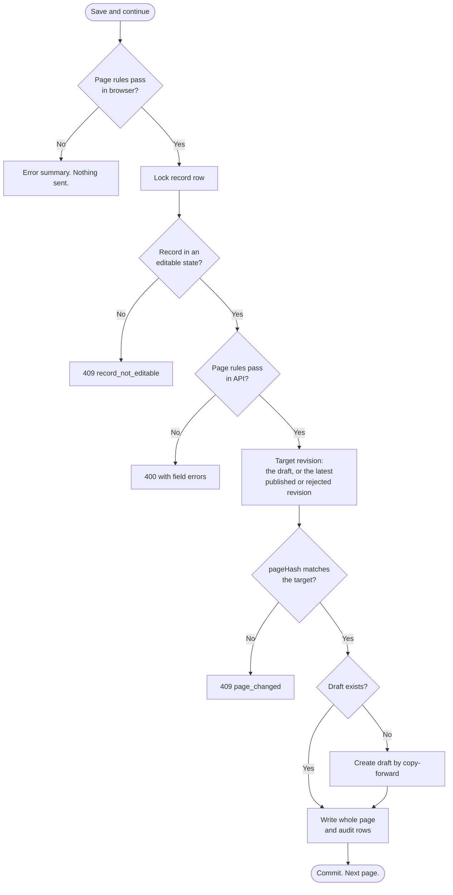

# Record validation and concurrency

How a record is validated, saved and submitted, and how two people editing the same record are kept from overwriting each other.

**Contents**

- [Summary](#summary)
- [Saving a page](#saving-a-page)
- [Cross-page rules](#cross-page-rules)
- [Check your answers and submit](#check-your-answers-and-submit)
- [Hashing](#hashing)
- [Two people at once](#two-people-at-once)
- [Errors](#errors)
- [Approaches we rejected](#approaches-we-rejected)
- [Open questions](#open-questions)

## Summary

- **Saving a page.** Page rules (mandatory, format, and rules between fields on the page) are validated in both the browser and the API. The whole page is saved, not only the fields the user edited, because saving confirms everything on it.
- **Concurrent saves.** A user can only overwrite answers they have seen. If anything on the page changed since it loaded, the save is blocked and the user reloads. Changes on other pages don't affect it.
- **Cross-page rules** need answers from more than one page, for example "the commercial launch date must be on or after the licence date, unless the medicine is in EAMS". They never block a save, meaming a record draft can be in an inconsistent state. These must be resolved before submission to QA.
- **Check your answers** runs every page rule across the whole record, so unanswered questions are caught, and every cross-page rule. Errors appear in the error summary with links to the fields that fix them, and Submit is hidden until there are none.
- **Submitting** is blocked if anything in the record changed since check your answers loaded, so the record submitted is the record the user reviewed. All the checks run again, because date-based rules can change even when the answers haven't.

Changes are detected with a pageHash and a cyaHash (check your answers hash, i.e. the entire revision), both calculated by the API (see [Hashing](#hashing)).

 

## Saving a page

Every page save goes through one service, in one transaction. It starts by locking the `records` row (`SELECT ... FOR UPDATE`), so saves and submits on one record happen one at a time.

- **Editable** means [status management](status-management.md) permits editing or creating a revision. A record isn't editable while its latest revision is in QA review, or while it is on hold, archived or discarded.
- **The API picks the target revision** from the database under the lock, not from the revision the page was loaded from. The first save after a publication or rejection creates the draft.
- **One page, one hash.** A change on another page never blocks this save.

### Single-question and multi-question pages

The flow is the same. On a page with several questions:

- page rules include the rules between fields on that page
- answers to questions that are now hidden are set to null, and each cleared answer gets its own audit row
- child rows, such as multi-select answers, are saved by set difference: rows for added values are inserted and rows for removed values are deleted
- a change to *any* field on the page blocks the save, even one this user didn't edit, because they are confirming the whole page

 

## Cross-page rules

Cross-page rules let users answer questions in any order without a correct answer ever being rejected. The content on each related page explains the rule, so users can (potentially) save a correct answer on a given page that breaks the rule, and then navigate to the other relevant page and update the answer there.

> **CR-01:** the commercial launch date must be on or after the licence date, unless the medicine is in EAMS.

Cross-page rules are checked on the check your answers page and prevent submission if the current answers are invalid. They are checked again on submission, meaning QA will only ever recieve records that are consistent.

**Estimated dates are compared as ranges.** An exact date is one day, a month covers the month and a quarter covers the quarter. Launch is only "before" licence if its range ends before the licence range starts, so a launch of 15 August 2026 against a licence in Q3 2026 is valid.

 

## Check your answers and submit

Anyone in the organisation can edit the draft at any time, so a colleague may save a change after check your answers loaded. Without a check, Submit would send QA answers the submitter never saw, or for a vaccine, publish them.

The record submitted must be exactly the record the user reviewed. This is done with the cyaHash: a fingerprint of the whole revision, taken when check your answers loads. Submit sends it back and the API recalculates it under the lock. If anything in the revision has changed, the submission is blocked with `409 record_changed`, and the user reloads check your answers to see the change before submitting again.

Loading check your answers also runs every check, and submitting runs them again under the lock:

```mermaid
flowchart TD
    S([Submit with cyaHash]) --> L[Lock record row and draft]
    L --> ST{Record in a<br/>submittable state?}
    ST -- No --> E0[409 record_not_editable]
    ST -- Yes --> D{cyaHash matches?}
    D -- No --> E1[409 record_changed.<br/>Reload check your answers]
    D -- Yes --> C{All checks pass?}
    C -- No --> E2[422. Back to check your<br/>answers with the errors]
    C -- Yes --> T{Record type}
    T -- Medicine --> M["Revision to qa_review.<br/>Insert qa_reviews row and<br/>submitted_to_qa event"]
    T -- Vaccine --> V["Publish the revision and record.<br/>Insert record_published event"]
    M --> OK([Commit. Confirmation page])
    V --> OK
```

- **Submittable** means [status management](status-management.md) permits Submit: the latest revision is a draft and the record is unpublished or published. A draft on an on-hold or archived record can't be submitted.
- **Checks run again even if the hash matches.** Date-based rules can change overnight when the data hasn't.
- **The revision ID is part of the cyaHash.** If a colleague submitted the draft, QA rejected it and a new draft ended up with the same answers, the user hasn't seen the rejection, so their submission is blocked.
- **Vaccines skip QA review.** The status changes on publication follow the [lifecycle](lifecycle.md#stage-8-qa-approves), including a status history row the first time the record is published.

 

## Hashing

Both hashes are SHA-256 of one shared, canonical serialisation. They are calculated by the API when needed and never stored. The browser only holds them and sends them back. If a colleague saves the same value, or saves without changes, no hash changes so nobody is blocked.

| | Covers | Calculated |
| --- | --- | --- |
| pageHash | The page's fields and child rows, from the target revision | On page load, and on save under the lock |
| cyaHash | The revision ID plus every section table and child row in the revision, including fields not shown | On check your answers load, and at submit under the lock |

**Serialisation rules**

- Fixed order of tables and fields, with table and field names included.
- Child rows sorted by a stable key.
- One format per type: ISO 8601 dates, invariant-culture decimals, enums as integers. Null and empty string are treated consistently.
- No audit columns, and no IDs that change on copy-forward. Where a row points at another section row (for example `record_mhra_dates` → `regulatory_dates`), serialise the values it points at. Reference data IDs are stable and can be included.

 
